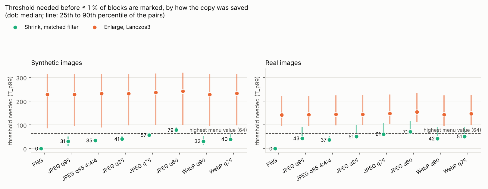
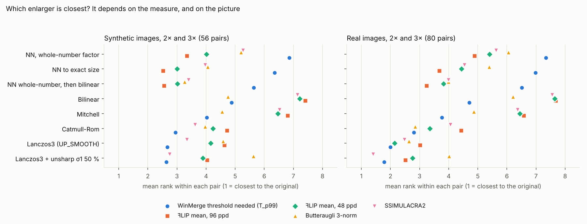

# Comparing images of different resolution in WinMerge: study report

*Session of 2026-10-14. Harness, data and page in this folder; findings log in `DISCOVERIES.md`.*

**In one paragraph.** To compare a picture with a resized copy of it, shrink the original to the
copy's size with the filter that reproduces the copy best; do not enlarge the copy. That makes an
unedited pair look clean (Pillow-made copies match exactly) and keeps 98 % of edits visible on the
synthetic set (real pictures: 96 %, all of them with lossless copies), where enlarging leaves about a
third of the 8×8 blocks marked at threshold 16 and finds 53–82 % of edits (real pictures: 51–95 %). Whole-number
nearest neighbour is honest about the copy's pixels and, at 2× on line art, flat colour and text, even
looks closer to the original to the models of the eye, but as a comparison it is no better than Lanczos3; an unsharp mask on top of
Lanczos3 is not worth it. All three modes are implemented for
WinIMerge (draft PR https://github.com/Ikkoru/winimerge/pull/2, alignment in
https://github.com/Ikkoru/winimerge/pull/1) with WinMerge menus (https://github.com/Ikkoru/winmerge/pull/1
and /pull/2). An eye-check page for flipping between the candidates:
https://claude.ai/artifact/6VCaQkq5egCxeAi9tqepCp (also `eyecheck/index.html`, works offline); round 2,
after your review: https://claude.ai/artifact/AZuXdaiba6Qw86YBqfJtyn (`eyecheck2/index.html`). Section 10
takes your three comparison goals one by one.

## 1. The question

WinMerge's image compare (WinIMerge) compares pixel by pixel at each image's own size, so a
picture and its lower-resolution copy never line up. The user compares duplicates found by a
duplicate finder (anime-style illustrations, manga, some photos); the low-resolution copy usually
comes from a website's resizing, often JPEG-compressed. Two features were requested:

1. place the smaller image in the centre instead of the top-left, and
2. enlarge the smaller image by the largest whole-number factor with nearest neighbour (NN),

with the question whether a smooth filter (e.g. Lanczos3 + a light unsharp mask) would make a
better comparison, and which filter settings are best. The brief (`notes/brief.md`, the user's
methodology document) asks for the best stand-in for the larger image, so
that flipping between the two shows what was changed and not what resampling did, measured with
tools that predict what a person sees when flipping.

## 2. Short answer

- **Compare at the smaller size.** Shrinking the original to the copy's size with the resampling
  filter that best reproduces the copy (WinIMerge `IMAGE_SCALING_DOWN_MATCHED`, "Shrink to Smallest
  (Matched Filter)") is the only way to make an unedited pair look clean, and it keeps real changes
  visible: on the synthetic set the threshold needed to leave ≤ 1 % of blocks marked is 2–5 for PNG
  copies and 42–60 for JPEG q85 copies (enlarging: 94–326), and 98 % of edits stay visible (Lanczos3
  enlargement 80 %, whole-number NN 53 %). On real pictures: 100 % with PNG copies (Lanczos3 94 %);
  with JPEG copies the smooth modes find about as many edits (92–94 %), but the shrink marks much more
  of each one (71 % of its blocks against 51 %). Copies made with Pillow's resize, OpenCV's area
  averaging, ImageMagick or WordPress are reproduced exactly or to within a level or two.
- **You were right that a smooth enlargement does not make the comparison truthful, but nearest
  neighbour does not either.** Any enlargement leaves about a third of the 8×8 blocks marked at threshold 16
  on detailed images, because the copy does not contain the detail. Whole-number NN marks about as many blocks as Lanczos3,
  with stronger differences, finds fewer edits, and below 2× or at factors like 2.5× it does not line the
  two images up at all (at 2.5× the copy is shown at 80 % of the original's size). It is the right view for pixel art (where it beats Lanczos3) and for looking at the
  copy's own pixels, so it is in the PR as requested. And for the eye it has a point with crisp art: at
  2× on your BenQ, ꟻLIP (which models flipping) rates the NN enlargement closer to the original than
  Lanczos3 in every pair of line art, flat colour, manga and text (89 % of the synthetic pairs, 65 % of
  the real ones), because 2× staircases are near the limit of acuity while a smooth filter softens every
  hard edge. For paintings and photos, at 3× and at non-integer factors Lanczos3 looks closer, and
  WinMerge's marks favour Lanczos3 throughout (section 4.10).
- **Lanczos3 + unsharp mask: not worth implementing.** Lanczos3 is the best common enlarger by WinMerge's
  outcome (FreeImage's
  8-bit and float paths measure the same). An unsharp mask (σ 0.5–1.5 px, 25–100 %) changes the
  threshold needed by −2 % to +20 % depending on strength, finds 1–3 points more edits, and sharpens
  JPEG noise with them. The enlargement mode in the PR is plain Lanczos3.
- **By goal (follow-up, section 10).** For finding edits in illustrations and photos the result holds and
  sharpens: with a lossless small copy the shrink marks every tiny edit down to a quarter of a copy pixel
  (enlarging: 51–60 %), with Diff Block Size 8/k and zoom to help the eye; only sub-pixel edits against a
  JPEG copy escape it. For pixel art it is exact. For judging which copy is cleaner it diverges: compare at
  the smaller size by eye after restoring JPEGs, not by WinMerge's marks; a one-time q90–q95 JPEG makes a
  lossless half-size copy redundant except for saturated colour saved 4:2:0, a re-saved one does not, and
  a JPEG thumbnail is almost never worth keeping (`harness/keep_check.py` does the measuring). The round
  trip is not needed: its gain was WinMerge's block size.
- **Implemented** as separate PRs in your forks: image alignment (nine anchors, including centre) and
  size matching (the three modes), each a library commit plus a small UI commit, with matching WinMerge
  menu PRs. The setting lives behind one API call, so the maintainer can put it wherever they want.

## 3. What was tested

### 3.1 Test material

17 large originals, used at their native resolution (no image was resampled to make it "large"):

| Set | Images | Size | Notes |
|---|---|---|---|
| Synthetic (`testset/synth`, made by `harness/synth.py`) | line art, flat-colour anime-style cel shading, painterly strokes, manga page with screentone, UI/text, pixel art (×8 NN), zone plate | 1200–1600 px | Rendered with skia at the final size (vector anti-aliasing, as a drawing program renders strokes). No licence restrictions. |
| Real (`testset/real`, sources in `testset/sources/MANIFEST.md`) | Pepper&Carrot cover and "Witches" (David Revoy, CC BY 4.0), Krita anime banner (CC BY-SA 4.0), Hokusai *Hodogaya* (Met, CC0), *The Starry Night* (PD), lion photo (CC0), astronaut (NASA, PD), coffee (CC0), Kenney pixel-art tiles (CC0), kitty terminal screenshot (GPL-3.0) | 512–1920 px wide; larger sources cropped at native resolution to ≤1600×1200 | Crops chosen automatically as the most detailed window (`testset/real/CROPS.json`). Several are JPEGs already (q≈87–100). No public-domain manga page with screentone was found on the reachable hosts; the synthetic manga page stands in. |

### 3.2 How the small copies were made

Unknown for real copies, so varied (`harness/resample.py`, `SHRINKERS`):

| Shrinker | What it stands for |
|---|---|
| `area` | OpenCV `INTER_AREA` (exact area averaging; Discord's lilliput) |
| `pil_bilinear` | Pillow BILINEAR (antialiased triangle) |
| `cv_linear` | OpenCV `INTER_LINEAR` without prefilter (aliases) |
| `pil_bicubic` | Pillow BICUBIC (Keys a = −0.5 = Catmull-Rom, antialiased) |
| `pil_lanczos` | Pillow LANCZOS (Lanczos3, antialiased) |
| `mitchell` | Mitchell–Netravali B = C = 1/3 (float reference implementation) |
| `lanczos_linear` | Lanczos3 in linear light |
| `lanczos_sharpened` | Pillow LANCZOS + unsharp mask σ 0.6, 60 % |
| `vips` | libvips `resize` (Lanczos3 with shrink/reduce) |
| `nearest` | Pillow NEAREST |

Factors 1.25, 1.5, 2, 2.5, 3, 4, with the small size rounded per axis (so the two axes' factors
differ slightly, as with real copies). Saved as PNG, JPEG q95/q85/q75/q60 at 4:2:0, q85 at 4:4:4,
WebP q90/q75 (Pillow/libjpeg-turbo, decoded with the same library).

### 3.3 Edits

Applied to the large image before shrinking, as a real variant would differ (`harness/edits.py`),
each placed automatically where the image has content: small text (20 px and 11 px), a 2-px line,
a 90-px recolour (+18/−6/−18 RGB), a black bar, a 96-px mosaic, a smudge (Gaussian σ 3), a
110-px region moved 2 px, and a 3-px dot (≈1 small pixel at 3×: the detection floor).

### 3.4 Candidates (how WinIMerge could show the pair)

Enlarging the small copy to the original's size (FreeImage, the library WinMerge ships; its
8-bit path and a float path):

| Candidate | Description |
|---|---|
| `nn_int_center` / `nn_int_topleft` | NN by the largest whole-number factor (the requested feature, **WinIMerge's `IMAGE_SCALING_UP_NEAREST_INTEGER`**), centred or top-left; the rest of the canvas is "missing" and counts as different, as in WinMerge |
| `nn` | NN to the exact size (uneven pixel widths at non-integer factors) |
| `sharp_bilinear` | NN by the whole-number factor, then bilinear to the exact size (CSS `image-rendering: pixelated` style) |
| `fi_bilinear`, `fi_bspline`, `fi_mitchell` | FreeImage filters |
| `fi_catmullrom`, `fi_lanczos3` | FreeImage, 8-bit intermediate (clips overshoot); `fi_lanczos3` is **WinIMerge's `IMAGE_SCALING_UP_SMOOTH`** |
| `fi_catmullrom_f`, `fi_lanczos3_f` | the same in float (`FreeImage_ConvertToRGBAF` first) |
| `ref_lanczos2_f`, `ref_lanczos4_f` | float reference implementation |
| `l3f_usm_rR_aA`, `crf_usm_…` | Lanczos3/Catmull-Rom float + unsharp mask, σ R ∈ {0.5, 0.75, 1, 1.5} px, amount A ∈ {25, 50, 75, 100} %, threshold 0 |
| `lin_lanczos3_f`, `lin_catmullrom_f` | resampled in linear light |

Comparing at the smaller size instead (shrinking the original to the copy's size):

| Candidate | Description |
|---|---|
| `down_area` | OpenCV area averaging |
| `down_fi_<k>` / `down_fi_<k>8` | FreeImage filter k (box, bilinear, B-spline, Mitchell, Catmull-Rom, Lanczos3), float / 8-bit path |
| `down_matched8a` | **WinIMerge's `IMAGE_SCALING_DOWN_MATCHED`**: FreeImage's box, bilinear, Mitchell, Catmull-Rom and Lanczos3 on the 8-bit path, plus exact area averaging; the one with the lowest mean absolute difference to the copy, chosen per pair |
| `down_matched8` | the same without the area-averaging candidate (the first version of the PR) |
| `down_matched` | the same choice among six filters (B-spline too) on the float path (an earlier variant; kept for comparison) |
| `down_oracle` | the shrinker that really made the copy (an upper bound) |

### 3.5 Measures

For every pair, against the large original (or, for `down_*`, the copy against the shrunk original):

- **WinMerge's own outcome**: the share of 8×8 blocks it marks (colour distance > T over R, G, B)
  at T = 0, 2, 4, 8, 16, 32, 64; regions (8-connected); and **T_p99**, the threshold that leaves
  at most 1 % of blocks marked. T_p99 is the single most practical number: the colour-distance
  setting a user would need before the diff stops being yellow everywhere.
- PSNR; worst-8×8-block mean colour distance; SSIM (global and worst 64-px tile).
- On a subset: **ꟻLIP** (NVIDIA; models flipping between two images) at 96 pixels per degree
  (the user's BenQ RD280U at 85 cm, 1:1 pixels) and 48 (2× zoom, or a DPI-unaware 200 % stretch),
  **Butteraugli** max and 3-norm, **SSIMULACRA2** (libjxl tools).
- **Edit detectability**: blocks touched by the edit (in the large image) vs. all other blocks
  (a guard ring of 3·factor+2 px around the edit is excluded). At the threshold that leaves 1 %
  (0.1 %) of blocks marked in the unedited twin pair, the share of edit blocks still marked, and
  whether any edit block is marked at all ("edit visible"); plus the number of unedited blocks
  louder than the edit's strongest block. The same test on ꟻLIP's error map (each block's maximum)
  asks whether the edit stands out for the eye when flipping (section 4.12).

### 3.6 Controls and geometry checks (run first)

- Every metric returns "identical" for an image against itself (block distance 0, PSNR ∞,
  ꟻLIP 0, Butteraugli 0, SSIMULACRA2 100) — `harness/metrics.py` self-test.
- The float reference resampler reproduces FreeImage's float path exactly (max |Δ| 0.0000, five
  kernels, both directions); WinMerge's FreeImage fork resamples bit-identically to FreeImage 3.18.
- Centroids of Gaussian blobs at sub-pixel positions stay within 0.04 px through every
  antialiased shrinker and a FreeImage enlargement (pixel-centre convention everywhere), except
  Pillow NEAREST at even factors (0.5 px shift) and NN enlargement at non-integer factors.
- Image borders are included in every number. Leaving out the outermost ring of 8×8 blocks changed
  T_p99 by at most 0.5 (matched shrink) and 1.7 (Lanczos3) and the share of blocks marked by less than
  half a point (27 pairs), so the libraries' different edge handling does not matter here.
- The WinIMerge implementation (C++) produces bit-identical output to the harness for all three
  scaling modes (Linux unit tests with the real `ImgDiffBuffer.hpp`). The one exception is the
  area-averaging candidate, for which the harness uses OpenCV's `INTER_AREA`: the C++ resampler agrees
  with it to within 1 level (0.2 % of the values differ).

## 4. Results

All numbers below are medians unless stated otherwise. `results/tables.md` has every table (generated by
`harness/report.py`, each table computed on the same pairs for all its rows); the CSVs are in `results/`.

### 4.1 Unedited pairs: how much does each WinIMerge mode leave marked?


Synthetic set, 7 images × 10 ways of making the copy = 70 pairs per cell; the three modes exactly as
WinIMerge implements them (whole-number NN; Lanczos3 on FreeImage's 8-bit path; the matched shrink
with its six candidates). **T_p99** is the colour-distance threshold that leaves at most 1 % of the
8×8 blocks marked (for scale: WinIMerge's threshold menu offers 0–64; the distance between two opaque colours runs to 442):

| copy saved as | mode | 1.25× | 1.5× | 2× | 2.5× | 3× | 4× |
|---|---|---|---|---|---|---|---|
| PNG | enlarge, whole-number NN | – | – | 238 | – | 321 | 314 |
| PNG | enlarge, Lanczos3 | 94 | 139 | 207 | 261 | 242 | 253 |
| PNG | **shrink, matched filter** | **3** | **4** | **2** | **5** | **3** | **4** |
| JPEG q85 | enlarge, whole-number NN | – | – | 248 | – | 326 | 317 |
| JPEG q85 | enlarge, Lanczos3 | 98 | 142 | 216 | 265 | 252 | 257 |
| JPEG q85 | **shrink, matched filter** | **45** | **46** | **42** | **52** | **53** | **60** |

"–": whole-number NN does nothing below 2×; at 2.5× it enlarges by 2, so the copy is shown at 80 % of the
original's size and lines up with it only at the alignment anchor, and the uncovered border is marked too.

Share of blocks still marked at the thresholds WinIMerge's menu offers (PNG copies / JPEG q85 copies):

| mode | factor | T = 8 | T = 16 | T = 32 | T = 64 |
|---|---|---|---|---|---|
| enlarge, whole-number NN | 2× | 37 % / 49 % | 35 % / 38 % | 33 % / 33 % | 16 % / 20 % |
| enlarge, Lanczos3 | 2× | 40 % / 53 % | 37 % / 42 % | 35 % / 35 % | 17 % / 23 % |
| shrink, matched filter | 2× | 0 % / 58 % | 0 % / 42 % | 0 % / 5 % | 0 % / 0.1 % |
| enlarge, whole-number NN | 2.5× | 92 % / 93 % | 82 % / 83 % | 78 % / 78 % | 71 % / 71 % |
| enlarge, Lanczos3 | 2.5× | 47 % / 55 % | 38 % / 45 % | 35 % / 36 % | 33 % / 34 % |
| shrink, matched filter | 2.5× | 0 % / 61 % | 0 % / 51 % | 0 % / 8.5 % | 0 % / 0.3 % |

What this says:

- **Shrinking is the only mode in which an unedited pair can look clean.** With PNG copies even a
  threshold of 8 leaves no block marked (median); with JPEG q85 copies the compression noise needs 64
  (≤ 0.4 % of blocks marked at every factor). The enlargers leave 8–35 % of the blocks marked even at
  64 (about a third from 2.5× up): the detail lost in the copy cannot be put back.
- **At whole-number factors, NN and Lanczos3 mark about the same share of blocks**; NN slightly fewer
  at low thresholds (it keeps flat areas exactly flat, while a smooth filter spreads each edge's error
  over more blocks), but its differences are stronger (T_p99 238 vs 207 at 2×, 321 vs 242 at 3×).
- **JPEG noise moves the problem**: at the small size a JPEG copy's noise is not diluted by enlarging,
  so at T = 8–16 the shrink mode marks as many blocks as the enlargers. It needs a higher threshold
  (64) but then gets clean; the enlargers never do.

By image (PNG copies, all factors): the matched shrink needs a threshold of 2–10 for every image (the
manga page with screentone is the hardest, at 10), the enlargers 79–342. **Pixel art is the one case
where whole-number NN beats Lanczos3** (24 vs 82); the matched shrink is better still (2).

### 4.2 How well does the matched filter reproduce the copy?

Which candidate the WinIMerge rule picks (synthetic, PNG copies, 42 pairs per way of making the copy):

| copy made with | picked | median T_p99 of the shrunk original vs the copy |
|---|---|---|
| Pillow BICUBIC | Catmull-Rom 42/42 | 0 (exact) |
| Pillow BILINEAR | bilinear 42/42 | 0 (exact) |
| Pillow LANCZOS | Lanczos3 42/42 | 0 (exact) |
| OpenCV `INTER_AREA` | area 40, box 2 | 0 (exact) |
| Mitchell (float reference) | Mitchell 42/42 | 1.7 (rounding) |
| libvips `resize` | Lanczos3 42/42 | 14 |
| Pillow LANCZOS + unsharp mask | Lanczos3 40, box 2 | 63 |
| OpenCV `INTER_LINEAR` (no antialiasing) | area 26, box 13, other 3 | 63 |
| Lanczos3 in linear light | Lanczos3 25, Catmull-Rom 12, other 5 | 76 |
| Pillow NEAREST | box 30, area 10, Lanczos3 2 | 196 |

- Choosing per pair beats any fixed filter: against a fixed Catmull-Rom shrink (8-bit) the matched
  shrink needs a lower threshold in 75 % of pairs, the same in 14 % and a higher one in 11 % (median
  T_p99 2.2 vs 42.6 for PNG copies, 48 vs 62 for JPEG q85). The true resampler (an upper bound no tool
  can know) gets 0 for PNG and 38 for JPEG q85.
- How often the pick is the resampler that really made the copy (where one of the candidates is it):
  99 % (synthetic) and 100 % (real) for PNG copies, but only 73 % and 56 % for JPEG q85 copies, where the
  compression removes the fine detail that tells the filters apart and a softer filter often wins.
  The outcome hardly suffers (next point).
- Picking by mean absolute difference is close to the best possible pick: judged by the outcome itself
  (each candidate's own T_p99 on the pair), it is within 1 level of the best candidate in 88 % of PNG
  pairs and 80 % of JPEG pairs, with the same median for PNG (2.2) and 48 vs 46 for JPEG. A fancier
  selection rule would gain little.
- The area-averaging candidate matters: without it (the PR's first version, five FreeImage filters)
  the medians were 10.4 (PNG) and 50.6 (JPEG), because FreeImage's box filter reproduces area averaging
  only at whole-number factors (`DISCOVERIES.md` §7).
- The 8-bit path matters: Pillow rounds to 8 bits between its two passes, as FreeImage's 8-bit path
  does, so the 8-bit FreeImage shrink reproduces Pillow copies exactly where the float path is off by
  a few levels (`DISCOVERIES.md` §3, §7).
- Copies that cannot be reproduced exactly are those whose resampler is in none of the candidates:
  linear-light resizing, sharpening after resizing, no antialiasing (nearest, OpenCV linear). They
  still compare far better than any enlargement.

**ImageMagick-made copies** (spot check, `harness/im_spotcheck.py`: ImageMagick 6.9 Q16, the 7 synthetic
images × factors 2, 2.5, 3; ImageMagick is behind many websites' thumbnails, WordPress's among them):

| copy made with | picked | median T_p99 (range) | Lanczos3 enlargement instead |
|---|---|---|---|
| `convert -resize` (Lanczos when shrinking) | Lanczos3 21/21 | 5.2 (1.7–43) | 234 |
| `-filter Catrom -resize` | Catmull-Rom 21/21 | 3.5 (1.7–23) | 241 |
| WordPress thumbnail, PNG (Triangle filter, `filter:support` 2.0) | bilinear 20, Mitchell 1 | 1.7 (1.7–7.3) | 244 |
| WordPress thumbnail, JPEG (+ `unsharpMaskImage(0.25, 0.25, 8, 0.065)`, quality 82) | bilinear 21/21 | 42 (34–116) | 253 |
| resized in linear light (`-colorspace RGB -resize … -colorspace sRGB`) | Lanczos3 11, Catmull-Rom 6, other 4 | 83 (15–165) | 291 |

ImageMagick keeps a 16-bit intermediate between its two passes, so its copies differ from FreeImage's
8-bit path by about one level (T_p99 1.7 is one level in each channel), more on the finest texture (the
manga page's screentone, 15–27). WordPress's recipe (read in `class-wp-image-editor-imagick.php`) is a
plain bilinear shrink: the wider support adds only zero-weight taps to the Triangle filter. Its light
sharpening of JPEG thumbnails disappears in the JPEG noise (42, like the Pillow JPEG q85 copies).

### 4.3 Enlargers compared, and the unsharp mask

Over all factors and both codecs (synthetic), median T_p99 and mean rank among the enlargers
(1 = needs the lowest threshold on that pair):

| enlarger | T_p99 PNG | T_p99 JPEG q85 | mean rank | blocks @T16 PNG |
|---|---|---|---|---|
| Lanczos4 (float) | 191 | 198 | 4.4 | 38.3 % |
| Lanczos3 + USM σ0.75 50 % | 190 | 194 | 4.5 | 37.9 % |
| **Lanczos3 (WinIMerge UP_SMOOTH; 8-bit and float the same)** | **195** | **199** | **4.6** | **37.6 %** |
| Lanczos3 + USM σ1.0 50 % | 188 | 196 | 4.9 | 38.2 % |
| Lanczos2 (float) | 206 | 209 | 5.5 | 37.7 % |
| Catmull-Rom (float) | 208 | 210 | 5.6 | 37.5 % |
| Mitchell | 211 | 213 | 6.3 | 38.0 % |
| bilinear | 215 | 219 | 7.2 | 38.0 % |
| NN whole-number, then bilinear to size | 236 | 240 | 8.4 | 36.4 % |
| NN to the exact size | 275 | 278 | 10.0 | 36.0 % |

- The Lanczos family is best by the threshold needed; Lanczos3 is FreeImage's built-in and within
  2 % of Lanczos4. The float path and the 8-bit path give the same medians here (the clipping matters
  at individual hard edges, `DISCOVERIES.md` §1).
- **Unsharp mask after Lanczos3 lowers the needed threshold by 2–4 %** (PNG and JPEG copies alike)
  **but marks more blocks at T = 16 with JPEG copies** (43.5–44.1 % instead of 41.9 %), because it
  sharpens the JPEG noise and the ringing along with the edges.
  The full grid (σ 0.5–1.5 px × 25–100 %) is in section 4.9. Not worth a mode.
- Nearest neighbour to the exact size is the worst by threshold, though it marks the fewest blocks at
  T = 16 for the reason given in 4.1.

### 4.4 Edits: can a real change still be seen?


1008 edited pairs (synthetic: 7 images × 9 edits × 2 shrinkers (area, Pillow Lanczos) × factors 2, 2.5,
3, 4 × PNG and JPEG q85). For each pair the threshold is set where 1 % of the *unedited* blocks of its
unedited twin are marked (a strict but fair setting: the user tunes the threshold until the noise
is gone), and the edit counts as visible when at least one of its blocks is still marked.

| mode | edit visible | … at the 0.1 % threshold | share of the edit's blocks marked | unchanged blocks louder than the edit (median) |
|---|---|---|---|---|
| enlarge, whole-number NN | 53 % | 34 % | 29 % | 198 |
| enlarge, NN to exact size | 76 % | 60 % | 41 % | 8 |
| enlarge, bilinear | 72 % | 60 % | 40 % | 8 |
| enlarge, Catmull-Rom (float) | 77 % | 65 % | 44 % | 0 |
| **enlarge, Lanczos3 (WinIMerge UP_SMOOTH)** | **80 %** | **66 %** | **46 %** | **0** |
| enlarge, Lanczos3 + USM σ1.0 50 % | 82 % | 68 % | 48 % | 0 |
| shrink, fixed Catmull-Rom (8-bit) | 94 % | 89 % | 78 % | 0 |
| shrink, five FreeImage filters matched (first version) | 97 % | 93 % | 85 % | 0 |
| **shrink, matched filter (WinIMerge DOWN_MATCHED)** | **98 %** | **94 %** | **87 %** | **0** |
| shrink, the true filter (upper bound) | 99 % | 95 % | 88 % | 0 |

The matched shrink is within one point of the upper bound (knowing the true resampler). By edit
(share visible): the hardest edits are the faint recolour (+18/−6/−18 RGB over 90 px: matched shrink
89 %, Lanczos3 54 %, whole-number NN 37 %), the smudge (96 % / 67 % / 24 %) and the 3-px dot, which is
about one pixel of the copy at 3× (100 % / 62 % / 38 %). Text, bars, lines, mosaics and moved regions
are found by every smooth mode almost always. By factor, the matched shrink stays at 96–99 %, Lanczos3
falls from 89 % (2×) to 67 % (4×), and whole-number NN is at 0 % at 2.5× (the copy is shown at 80 % of
the original's size, so nothing lines up) and 58–87 % elsewhere. PNG and JPEG q85 copies
differ little (matched shrink 100 % vs 97 %).

The unsharp mask makes edits slightly easier to see among the enlargers (82 % vs 80 %, mostly the
small dot and the small text), but comparing at the smaller size is far ahead of any enlarger.

**Real images** (1080 edited pairs: the 10 real originals × the 9 edits × Pillow Lanczos and area copies
× factors 2, 2.5, 3 × PNG and JPEG q85; same rule for the threshold):

| mode | edit visible, PNG / JPEG | … at the 0.1 % threshold | share of the edit's blocks marked |
|---|---|---|---|
| enlarge, whole-number NN | 51 % / 51 % | 30 % / 29 % | 25 % / 24 % |
| enlarge, NN to the exact size | 91 % / 92 % | 69 % / 69 % | 44 % / 43 % |
| **enlarge, Lanczos3 (UP_SMOOTH)** | **94 % / 93 %** | **82 % / 82 %** | **53 % / 51 %** |
| enlarge, Lanczos3 + unsharp σ1 px 50 % | 95 % / 94 % | 83 % / 82 % | 54 % / 52 % |
| **shrink, matched filter (DOWN_MATCHED)** | **100 % / 92 %** | **100 % / 88 %** | **100 % / 71 %** |
| shrink, the true filter (upper bound) | 100 % / 92 % | 100 % / 87 % | 100 % / 72 % |

- On real pictures the enlargers do better than on the synthetic set (photos and paintings have less
  hard-edged detail for an enlargement to get wrong). With PNG copies the matched shrink still finds every
  edit in every pair; with JPEG copies all the smooth modes find about as many edits (92–94 %), but the
  shrink marks much more of each edit (71 % of its blocks against 51 %), so an edit shows as a shape
  rather than a few scattered blocks.
- The shrink's weak spot is the faint recolour in a JPEG copy: found in 55 % of the pairs, against 73 %
  for Lanczos3 and 87 % for NN. +18/−6/−18 RGB is a colour distance of 26, below the JPEG noise of the
  small copy (the threshold there is 40–60); in an enlarged comparison the same shift adds to differences
  that are already there and pushes some blocks over the (much higher) threshold. The 3-px dot (one pixel
  of the copy at 3×) is the other hard case (75 % for every smooth mode).
- Whole-number NN finds about half of the edits: at 2.5× nothing lines up (0 %), and at 3× the copy's
  rounded size (533 px for 1600) makes the whole-number grid drift by up to a pixel against the original
  (57 %); at 2× it finds 95 %, as many as Lanczos3.

### 4.5 Real images

10 real originals (illustrations, a woodblock print, a painting, photos, pixel-art tiles, a terminal
screenshot; `testset/sources/MANIFEST.md`), copies made with 7 resizers (Pillow bilinear/bicubic/Lanczos,
libvips, OpenCV area and linear, Lanczos in linear light) at the same six factors, PNG and JPEG q85:
840 pairs per mode. Median T_p99 (70 pairs per cell):

| copy saved as | mode | 1.25× | 1.5× | 2× | 2.5× | 3× | 4× |
|---|---|---|---|---|---|---|---|
| PNG | enlarge, whole-number NN | – | – | 167 | – | 237 | 246 |
| PNG | enlarge, Lanczos3 | 85 | 104 | 127 | 154 | 167 | 189 |
| PNG | **shrink, matched filter** | **2** | **1** | **0** | **1** | **1** | **1** |
| JPEG q85 | enlarge, whole-number NN | – | – | 170 | – | 238 | 246 |
| JPEG q85 | enlarge, Lanczos3 | 90 | 111 | 137 | 159 | 173 | 196 |
| JPEG q85 | **shrink, matched filter** | **43** | **47** | **50** | **58** | **60** | **62** |

- Same picture as the synthetic set, more clearly: with PNG copies the matched shrink leaves **no**
  block marked at threshold 16 at any factor (median), while Lanczos3 leaves 37–65 % and whole-number NN
  55–99 %. At threshold 64 the matched shrink leaves ≤ 0.8 % even with JPEG copies; Lanczos3 3–25 %.
- Per image (PNG copies): the matched shrink needs 0–1 for every image; Lanczos3 53 (the painterly
  Pepper&Carrot cover) to 244 (the pixel-art tiles); NN 127–327. With JPEG q85 copies the matched shrink
  needs 40–60 for illustrations, paintings and photos, but 93 for the pixel-art tiles and 116 for the
  terminal screenshot: JPEG at the small size is hard on text and hard pixel edges.
- Per resizer (PNG copies): Pillow's three and OpenCV's area copies are reproduced exactly (0–1),
  libvips closely (6), OpenCV `INTER_LINEAR` (49) and linear-light Lanczos (71) cannot be. The picks
  were right every time for the reproducible ones (60/60 each).

### 4.6 JPEG chroma upsampling

Does it matter how the decoder upsamples a 4:2:0 JPEG's colour? 42 synthetic pairs (7 images ×
Pillow Lanczos and area × factors 2, 2.5, 3), copy saved as JPEG q85 4:2:0, decoded by libjpeg-turbo's
`djpeg` with its default smooth ("fancy") chroma upsampling and with `-nosmooth` (replicated chroma;
`harness/chroma_test.py`):

| mode | upsampling | median T_p99 | blocks @T16 | blocks @T64 |
|---|---|---|---|---|
| shrink, matched filter | smooth (default) | 40 | 44 % | 0 % |
| shrink, matched filter | replicated | 42 | 49 % | 0 % |
| enlarge, Lanczos3 | smooth (default) | 249 | 45 % | 33 % |
| enlarge, Lanczos3 | replicated | 249 | 48 % | 33 % |

The decoder's default is slightly better (2 levels, 3–5 points of blocks at threshold 16) and the
difference is far smaller than the JPEG noise itself. FreeImage's JPEG plug-in uses libjpeg's default.

### 4.7 How the copy was saved (JPEG and WebP quality, chroma subsampling)

The 7 synthetic images × Pillow Lanczos and area copies × factors 2 and 2.5, saved eight ways (28 pairs
per codec; `results/codec_synth.csv`). For the matched shrink, the distribution over the pairs of the
threshold needed (T_p99), and what the menu's highest values leave marked:



| copy saved as | T_p99 median (90th percentile, max) | blocks @T32 | blocks @T64 | pairs clean (≤ 1 %) at 64 | Lanczos3 enlargement instead |
|---|---|---|---|---|---|
| PNG | 0 (1, 1.7) | 0 % | 0 % | 100 % | 228 |
| JPEG q95 | 31 (51, 55) | 1.0 % | 0 % | 100 % | 229 |
| JPEG q85, 4:4:4 | 35 (38, 45) | 1.9 % | 0 % | 100 % | 232 |
| JPEG q85 | 41 (53, 64) | 4.8 % | 0.04 % | 96 % | 232 |
| JPEG q75 | 57 (62, 72) | 22 % | 0.4 % | 93 % | 237 |
| JPEG q60 | 79 (91, 95) | 31 % | 5.3 % | 14 % | 242 |
| WebP q90 | 32 (54, 63) | 1.0 % | 0 % | 100 % | 229 |
| WebP q75 | 40 (60, 65) | 3.8 % | 0.07 % | 96 % | 233 |

(JPEG without a note is 4:2:0, Pillow's default and the web's usual choice.)

- The threshold the matched shrink needs follows the compression: about 30 for high-quality JPEG and
  WebP, 40 at JPEG q85 and WebP q75, 57 at q75, 79 at q60. Up to q75 the menu's highest value (64)
  leaves at most 0.4 % of the blocks marked; at q60 it leaves 5 %.
- Chroma subsampling makes the worst blocks worse: at q85, 4:4:4 needs 35 (90th percentile 38), 4:2:0
  needs 41 (53); even q95 at 4:2:0 has a long tail (51), at saturated colour edges.
- The enlargers hardly notice the codec (Lanczos3 228–242): the resampling difference swamps the
  compression noise.

**Real pictures** (the 10 real originals, 40 pairs per codec): the matched shrink needs 0 (PNG), 43
(q95), 37 (q85 4:4:4), 51 (q85), 61 (q75), 71 (q60), 42 (WebP q90), 51 (WebP q75); Lanczos3 enlargement
142–156. Illustrations, paintings and photos need 31–61 at q85–q95, but the pixel-art tiles and the
terminal screenshot need 85–140 at every JPEG and WebP quality, and about half that at 4:4:4 (50 and 66):
4:2:0 subsampling smears their coloured hard edges, and at the small size every such edge is a large
share of a block. So 64 cleans 80 % of the real JPEG q85 pairs; the rest are pixel art and text.

### 4.8 Restoring the small JPEG with jpegQS before comparing

You pass JPEG copies through jpegQS (QuantSmooth) and open the restored PNGs in WinMerge; the brief also
asked whether WinMerge should do that itself. Copies saved as JPEG q85 and q60 (4:2:0), then restored with
jpegQS `-q 3` and `-q 6` (`jpegqs -q N -i 0 -t 1`), compared with the original; 4 synthetic images (flat
colour, line art, manga, painterly) × Pillow Lanczos and area copies × factors 2, 2.5, 3, unedited (24
pairs per setting) and with small text or a thin line (48 edited pairs per setting):

| mode | copy | T_p99 | blocks @T16 | blocks @T32 | edits visible | edit blocks marked |
|---|---|---|---|---|---|---|
| shrink, matched filter | JPEG q85 | 39 | 40 % | 6.0 % | 100 % | 91 % |
| | q85 + jpegQS -q 3 | 52 | 41 % | 9.1 % | 100 % | 91 % |
| | q85 + jpegQS -q 6 | 50 | 35 % | 8.8 % | 100 % | 91 % |
| | JPEG q60 | 78 | 54 % | 26 % | 100 % | 90 % |
| | q60 + jpegQS -q 3 | 90 | 51 % | 26 % | 100 % | 89 % |
| | q60 + jpegQS -q 6 | 91 | 48 % | 26 % | 100 % | 88 % |
| enlarge, Lanczos3 | JPEG q85 | 206 | 44 % | 27 % | 90 % | 63 % |
| | q85 + jpegQS -q 6 | 208 | 40 % | 27 % | 90 % | 63 % |
| | JPEG q60 | 215 | 51 % | 31 % | 85 % | 62 % |
| | q60 + jpegQS -q 6 | 223 | 45 % | 30 % | 88 % | 60 % |

- **jpegQS does not help the comparison; it makes it slightly harder.** With the matched shrink, the
  threshold needed rises in 88–100 % of the pairs (median +8 to +12 levels), on every image. jpegQS
  removes much of the faint, widespread JPEG noise (a few points fewer blocks marked at 8–16), but its
  smoothed estimate of the lost detail departs from the original by more than the JPEG noise did in some
  places (the worst blocks get worse). Edits are found as often as without it. Restoring before enlarging
  (the brief's suggestion 3) does not help either: Lanczos3 needs up to 9 more.
- Real pictures (both Pepper&Carrot images, the Hokusai print, the lion photo; same settings, 24
  unedited and 48 edited pairs per setting) behave the same way: the matched shrink needs 43 → 54–55
  at q85 and 65 → 75–78 at q60, Lanczos3 89 → 92–93; every edit is found with or without jpegQS.
- So for finding edits, open the JPEG as it was downloaded, or, with jpegQS PNGs, set the threshold
  about 10 higher; adding jpegQS to WinMerge for diffing (an LGPL-2.1 dependency) would not pay off.
  Choosing which copy to keep is a different question: there jpegQS belongs in the comparison, because
  it can only undo the last save and the copy you keep will be viewed restored (section 10.3).
- The measure here is WinMerge's own (where the largest differences are); the earlier finding that
  jpegQS raises SSIMULACRA2 (the brief, item 9) is about how good the copy looks, a different question.
  Part of the effect may come from `-q 6` writing 4:2:0 input out as 4:4:4 with its own chroma
  upsampling (inferred, not separated here).

### 4.9 The unsharp-mask sweep

Lanczos3 (float) followed by an unsharp mask, radius σ 0.5–1.5 px × amount 25–100 %, threshold 0, on 7
synthetic images × 2 shrinkers × factors 1.5, 2, 3 × PNG and JPEG q85, unedited and with four edits
(small text, a thin line, the 3-px dot, a moved region): 420 pairs per setting. Change against plain
Lanczos3:

Threshold needed (T_p99, PNG copies), % change (negative = better):

| σ \ amount | 25 % | 50 % | 75 % | 100 % |
|---|---|---|---|---|
| 0.5 px | −0.9 | −0.9 | −1.8 | −1.8 |
| 0.75 px | −0.9 | −1.6 | −0.4 | +1.8 |
| 1.0 px | −1.6 | 0.0 | +4.0 | +9.3 |
| 1.5 px | −0.4 | +5.3 | +14.2 | +20.0 |

Blocks marked at threshold 16 with JPEG q85 copies, change in percentage points: +0.0 (σ 0.5, 25 %) to
+3.9 (σ 1.5, 100 %); +1.0 at σ 1.0, 50 %. Edits still visible (at the 1 % threshold): 89 % without
sharpening, 91–92 % with any of the settings (+1.2 to +2.7 points, not growing with strength).

So the brief's candidate (radius 1 px, 40–60 %, threshold 0) leaves the threshold where it was, finds
2.7 points more edits, and marks 1 point more blocks on JPEG copies. The best settings by threshold
(σ 0.5 px, 75–100 %) gain under 2 %. Strong sharpening (σ ≥ 1 px with ≥ 75 %) makes things clearly
worse (+4 to +20 %), because the halos it adds are differences too. Catmull-Rom behaves the same way
(203 vs 205 with σ 1.0 px, 50 %). Next to comparing at the smaller size (threshold 2–5, 98 % of edits
visible), none of this matters, so WinIMerge's enlargement mode stays plain Lanczos3.

On real pictures (5 of them: both Pepper&Carrot images, the Hokusai print, the lion photo, the terminal
screenshot; 60 unedited and 240 edited pairs) the result is the same. The brief's candidate (σ 1 px,
50 %) leaves the threshold needed where it was (89 against 89), marks 2.3 points more blocks at
threshold 16 and finds 1.3 points more edits (96 % against 95 %). The best setting by threshold (σ 0.5
px, 75 %) gains 1 %; the strongest (σ 1.5 px, 100 %) finds 3 points more edits but needs a 28 % higher
threshold and marks 7 points more blocks.

### 4.10 Perceptual metrics: what the models of the eye say

ꟻLIP (at 96 and 48 pixels per degree), Butteraugli (max-norm and 3-norm) and SSIMULACRA2 on unedited
pairs: copies made with Pillow Lanczos and OpenCV area averaging × factors 2, 2.5, 3 × PNG and JPEG q85,
of the 7 synthetic images (84 pairs) and the 10 real ones (120 pairs) (`results/heavy_*.csv`;
`harness/heavy_analysis.py`). The enlargers are compared with the original at its size, the matched
shrink at the copy's size (so its numbers describe a smaller picture). Medians at 2× and 3× (lower is
closer, except SSIMULACRA2), each cell PNG / JPEG copies:

| mode | ꟻLIP @96 | ꟻLIP @48 | Butteraugli 3-norm | SSIMULACRA2 | T_p99 |
|---|---|---|---|---|---|
| *synthetic images (28 pairs per codec)* | | | | | |
| enlarge, whole-number NN | 0.041 / 0.084 | 0.063 / 0.109 | 6.2 / 6.3 | 22 / 15 | 274 / 276 |
| enlarge, NN to the exact size | 0.038 / 0.082 | 0.059 / 0.109 | 5.6 / 6.2 | 24 / 15 | 251 / 257 |
| enlarge, bilinear | 0.044 / 0.091 | 0.064 / 0.111 | 5.4 / 6.1 | 17 / 4 | 220 / 224 |
| **enlarge, Lanczos3 (UP_SMOOTH)** | **0.041 / 0.085** | **0.064 / 0.108** | **5.7 / 6.0** | **25 / 20** | **220 / 227** |
| enlarge, Lanczos3 + unsharp σ1 px 50 % | 0.043 / 0.083 | 0.065 / 0.109 | 6.2 / 6.4 | 26 / 22 | 227 / 235 |
| **shrink, matched filter (DOWN_MATCHED)** | **0 / 0.024** | **0 / 0.031** | **0 / 0.98** | **100 / 81** | **0 / 40** |
| *real images (40 pairs per codec)* | | | | | |
| enlarge, whole-number NN | 0.060 / 0.105 | 0.095 / 0.137 | 4.4 / 4.7 | 44 / 28 | 192 / 195 |
| enlarge, NN to the exact size | 0.052 / 0.100 | 0.088 / 0.134 | 4.0 / 4.4 | 44 / 30 | 202 / 206 |
| enlarge, bilinear | 0.060 / 0.106 | 0.104 / 0.140 | 3.9 / 4.2 | 33 / 23 | 164 / 165 |
| **enlarge, Lanczos3 (UP_SMOOTH)** | **0.043 / 0.098** | **0.078 / 0.128** | **3.5 / 3.9** | **47 / 33** | **149 / 152** |
| enlarge, Lanczos3 + unsharp σ1 px 50 % | 0.041 / 0.092 | 0.075 / 0.131 | 3.6 / 4.0 | 51 / 34 | 143 / 148 |
| **shrink, matched filter (DOWN_MATCHED)** | **0 / 0.045** | **0 / 0.065** | **0 / 1.07** | **100 / 79** | **0 / 53** |



- **Every measure puts the matched shrink far ahead.** With PNG copies it is identical to the copy; with
  JPEG copies only the compression noise remains (ꟻLIP 0.024–0.045 against 0.082–0.106 for the
  enlargers, SSIMULACRA2 79–81 against 4–34). Over all candidates the perceptual measures order the pairs
  much as WinMerge's outcome does (mean within-pair Spearman correlation with T_p99: 0.71–0.85 synthetic,
  0.76–0.91 real).
- **Among the enlargers, which looks closest depends on the picture.** ꟻLIP, the measure built to
  predict what a viewer notices when flipping between two images, rates nearest neighbour (to the exact
  size) closer to the original than Lanczos3 at 2× in 89 % of the synthetic pairs and 65 % of the real
  ones: in *every* pair of line art, flat colour, manga, UI text, the Krita anime banner and the terminal
  screenshot, and in most of Van Gogh's, but in few of the photos and paintings (Pepper&Carrot 0–12 %,
  Hokusai 12 %, the photos 25–38 %). At 3× NN wins 64 % of the synthetic and 28 % of the real pairs; at
  2.5× (uneven pixel widths) it loses on every measure. On the real pictures overall ꟻLIP ranks Lanczos3
  (with or without the unsharp mask) first.
- The other measures lean towards Lanczos3: Butteraugli's 3-norm prefers NN in 71 % of the synthetic and
  35 % of the real pairs at 2×, SSIMULACRA2 in 50 % and 45 %, WinMerge's threshold in 14 % and 0 %.
  Among the enlargers, the within-pair correlation with T_p99 is −0.06 (synthetic) and 0.43 (real) for
  ꟻLIP, 0.47 and 0.63 for SSIMULACRA2: what WinMerge marks and what the eye models predict agree on
  photos and paintings, much less on hard-edged art.
- Why: at 96 ppd one pixel of a 2× NN enlargement spans 1.25 arcminutes, close to the limit of visual
  acuity, so its staircases hardly show, while a smooth filter visibly lowers the contrast of every hard
  edge. Where the edges are soft anyway (paintings, photos) the smooth filter costs little and the
  staircase is the more visible error. WinMerge counts every staircase pixel at its full colour
  difference. At 48 ppd (the BenQ at 2× zoom or stretched by Windows, or roughly the HP and Packard Bell
  monitors at 1:1) the staircases become visible and NN's lead shrinks: closer than Lanczos3 in 75 % of
  the synthetic and 30 % of the real pairs at 2×.
- Whole-number NN ranks a little below NN to the exact size, because when the small size was rounded
  (1600 px / 3 = 533) the copy's grid drifts by up to a pixel against the original's.
- The unsharp mask: on real pictures ꟻLIP and SSIMULACRA2 rank Lanczos3 + unsharp mask first and
  Butteraugli's max-norm ranks it last (its halos are the worst spots); on synthetic art ꟻLIP is mixed.
  As in 4.9, no clear gain. Lanczos3 on the 8-bit path and in float differ by under 2 % on every median.
- For edits, ꟻLIP agrees with WinMerge (section 4.12): an edit stands out of the resampling noise in
  ꟻLIP's map in 94–95 % of the pairs with either enlarger and in 100 % at the small size.

So the eye models side with you about nearest neighbour for crisp line art, flat colour, manga and text
viewed at 2×, which is much of what you compare, while for paintings and photos, and at 3× or
non-integer factors, Lanczos3 looks closer. WinMerge's marks side with Lanczos3 throughout. Neither
enlargement comes close to comparing at the smaller size.

### 4.11 Resampling in linear light

Most tools resample the gamma-encoded sRGB values directly; resampling in linear light is often called
more correct (it keeps the brightness of fine detail). Enlarging in linear light (`lin_*`: sRGB → linear,
FreeImage float resample, → sRGB) against the usual way, 7 synthetic images × copies made with OpenCV area
averaging, Pillow Lanczos, and Lanczos3 in linear light × factors 2, 2.5, 3, PNG (63 unedited pairs, 126
with small text or a thin line):

| enlarger | T_p99 for copies made by: area | Pillow Lanczos | Lanczos3 in linear light | edits visible |
|---|---|---|---|---|
| Lanczos3 (float) | 260 | 232 | 288 | 87 % |
| Lanczos3 in linear light | 284 | 236 | 288 | 87 % |
| Catmull-Rom (float) | 251 | 229 | 286 | 82 % |
| Catmull-Rom in linear light | 258 | 230 | 286 | 84 % |

- Enlarging in linear light does not help, not even for copies that were themselves made in linear
  light (288 either way); for area-averaged copies it is worse (284 against 260). The share of blocks
  marked moves by under half a point and edits are found as often. On the 10 real pictures (90 unedited,
  180 edited pairs) it is slightly worse everywhere: Lanczos3 needs 152–165 in linear light against
  147–155 in sRGB (even for linear-light copies: 165 against 155) and marks 3–5 points more blocks at
  threshold 16; edits are found equally often (95–97 %). The enlargement mode stays in sRGB.
- Linear light matters for the *shrink*: copies made in linear light are the ones the matched shrink
  cannot reproduce (median T_p99 76 synthetic, 71 real, 83 for ImageMagick's `-colorspace RGB`), while
  shrinking the original the same way would reproduce them exactly (0 for PNG copies, 42–64 for JPEG
  q85). A linear-light Lanczos3 candidate in DOWN_MATCHED (FreeImage's float path between two gamma
  conversions) would close that gap at the cost of one more resample; it is left out because the common
  web resizers measured here (Pillow, libvips, ImageMagick, WordPress) work in sRGB by default.

### 4.12 Round trip: enlarge both panes after the matched shrink (the brief's suggestion 4)

The brief asked to compare two ways of using the matched shrink: compare at the copy's size (WinIMerge
DOWN_MATCHED), or enlarge *both* the shrunk original and the copy back to the original's size with the
same filter, so that both panes carry the same blur, and compare there. `harness/roundtrip_test.py`:
7 synthetic images × Pillow Lanczos and area copies × factors 2 and 3 × PNG and JPEG q85, unedited and
with four hard edits (small text, a thin line, the faint recolour, the 3-px dot; 224 edited pairs). Edits
are counted as visible as in 4.4, and also when the edit's block stands out in ꟻLIP's error map at 96 ppd
(threshold where 1 % of the unedited twin's blocks exceed it):

| candidate | T_p99 JPEG | blocks @T16 JPEG | ꟻLIP @96 JPEG | edits visible, PNG / JPEG | edit stands out in ꟻLIP, PNG / JPEG |
|---|---|---|---|---|---|
| compare at the small size (DOWN_MATCHED) | 40 | 43 % | 0.024 (0.045 viewed zoomed k×) | 100 % / 96 % | 100 % / 100 % |
| round trip, both enlarged with Lanczos3 | 32 | 27 % | 0.038 | 100 % / 100 % | 100 % / 100 % |
| round trip, both enlarged with bilinear | 28 | 14 % | 0.034 | 100 % / 100 % | 100 % / 98 % |
| enlarge the copy with Lanczos3 (UP_SMOOTH) | 227 | 44 % | 0.085 | 78 % / 78 % | 95 % / 95 % |
| enlarge the copy with NN to the exact size | 257 | 42 % | 0.082 | 75 % / 74 % | 94 % / 94 % |

With PNG copies all three ways of using the matched shrink are exact (T_p99 0, every edit found). With
JPEG copies the round trip is somewhat better: enlarging both panes smooths their difference, which
lowers the fine-grained compression noise more than the edits, so it needs a lower threshold (32 with
Lanczos3, 28 with bilinear, against 40), marks fewer blocks at threshold 16, and found the faint recolour
in every pair (91 % at the small size). Seen at the same size on screen, it also flickers less than the
small comparison zoomed in (ꟻLIP 0.038 against 0.045). The costs: comparing at the original's size
(about 15× slower per comparison at 4×, section 8), a second resample of both images, and both panes
shown softened (the original pane is no longer the original).

On 5 real pictures (both Pepper&Carrot images, the Hokusai print, the lion photo, the terminal
screenshot; 40 unedited and 160 edited pairs) the result is the same. With PNG copies every way of using
the matched shrink is exact and finds every edit (Lanczos3 enlargement: 91 %). With JPEG copies the round
trip needs a threshold of 42 (Lanczos3) or 35 (bilinear) instead of 47, marks 40 % or 24 % of the blocks
at threshold 16 instead of 61 %, and finds 88–91 % of the edits instead of 84 % (Lanczos3 enlargement
86 %), the faint recolour most of all (88–95 % against 82 %).

So for JPEG copies the round trip looked like the best of all the ways tried, by a few points; for PNG
copies it changes nothing. The follow-up (section 10.1) found where those points come from: WinMerge
marks 8×8 blocks of the images it compares, which in the round trip cover 8×8 pixels of the original
but at the small size 8k × 8k. With the same block area (WinMerge's Diff Block Size set to 8/k at the
small size) the plain matched shrink finds as many edits as the round trip, with Lanczos3 or bilinear,
and needs the same threshold. The round trip is therefore not needed as a mode.

## 5. Is anything other than nearest neighbour a flawed comparison?

Partly right, but the measurements turn the argument around.

**What whole-number NN does well.** Every pixel it shows is a pixel of the copy, unchanged, and
nothing is invented. That is the right view when looking *at the copy* (pixel art, checking its
compression artefacts, counting pixels), and when the copy was itself made by whole-number NN the
comparison becomes exact (no differences at all; unit-tested).

**What it does to the comparison.** WinMerge compares what is shown with the original, pixel by
pixel. The original has its edges at full resolution; the NN-enlarged copy has the same edges as
k×k staircases. So every edge in the picture differs, by up to its full contrast, and NN needs a
*higher* threshold than any smooth filter before the diff stops being yellow everywhere (section 4).
NN avoids inventing values, but it does not avoid differences: it adds them. At factors that are not
whole numbers the two images do not line up at all: at 2.5× it enlarges 2×, so the copy is shown at
80 % of the original's size and only the alignment anchor (e.g. the centre) coincides; below 2× it does
nothing. NN to the exact size instead makes pixels unevenly wide and moves features by up to half a
copy pixel (`DISCOVERIES.md` §2).

**What the eye sees is another matter, and there you are right for crisp art at 2×.** The perceptual
models (section 4.10) rate the NN enlargement as *closer* to the original than Lanczos3 when the two are
viewed at 1:1 on your BenQ (96 pixels per degree), for line art, flat colour, manga and text: ꟻLIP, which
models flipping, in every such pair at 2× (89 % of the synthetic pairs, 65 % of the real ones, the
anime banner and the screenshot included). A 2× staircase is near the limit of visual acuity there,
while a smooth filter visibly softens every hard edge. For paintings and photos, at 3× (NN closer in
28 % of the real pairs), at 2.5×, at 48 pixels per degree (zoomed in), and with WinMerge's marks, NN
loses. So whole-number NN is a fair way to *look at* a 2× copy of line art next to the original, but not
a better way to have WinMerge find the differences.

**What a smooth filter does.** It estimates in-between values. The estimate is wrong exactly where the
copy lost detail, but it is closer to the original than a staircase, so fewer and weaker differences
remain. Lanczos3 is the closest of the common filters by WinMerge's own outcome, SSIMULACRA2 and the
share of edits found (for hard-edged art at 2×, ꟻLIP prefers NN, above). Still, on detailed
images about a third of all 8×8 blocks stay marked at threshold 16 whatever enlarger is used: the
detail is not in the copy, so no filter can bring it back, and an enlarged comparison can never be
clean.

**Lanczos3 + unsharp mask.** Sharpening moves the enlarged copy towards the original's edge contrast:
at the best settings the threshold needed drops by up to 2–4 % and slightly more edits stay visible
(1–3 points). But stronger settings add halos that are differences too (up to +20 %), every setting
sharpens the JPEG noise, and all of it stays far behind comparing at the smaller size (98 % of edits).
Not worth a mode of its own (sections 4.3, 4.4, 4.9).

**The honest comparison is at the smaller size.** Shrink the original the way the copy was made.
Then both images went through the same resampling, and what remains is what really differs: edits
and compression noise. That is WinIMerge's `IMAGE_SCALING_DOWN_MATCHED`. The cost is that
differences smaller than one pixel of the copy cannot be seen, but the copy cannot show them anyway.

The brief also suggested a variant: after the matched shrink, enlarge *both* images with the same
filter and compare at the large size, so both carry the same blur. Measured (section 4.12), it is the
same as comparing at the small size for lossless copies and a little better for JPEG copies (the
enlargement smooths the compression noise in the difference more than the edits: threshold 32 instead
of 40 on the synthetic set, 35–42 instead of 47 on real pictures, and a few points more edits found), at
the cost of comparing at the large size (about 15× slower per comparison at 4×) and of showing both
panes softened. Only the compare-at-the-smaller-size
version was implemented; the round trip would be a small follow-up if wanted.

## 6. Recommendations

For the WinIMerge/WinMerge feature (implemented in the PR branches, see `notes/upstream-drafts.md`):

1. Offer **Shrink to Smallest (Matched Filter)** as the mode for resized copies, **Enlarge by Whole
   Number (Nearest Neighbor)** for pixel art and for inspecting the copy, and **Enlarge to Largest
   (Lanczos)** for viewing a small copy next to the original at the same size. Keep **None** as the
   default (today's behaviour).
2. Match the filter on FreeImage's 8-bit path (what Pillow and most libraries do), with exact area
   averaging as an extra candidate, and choose by the lowest mean absolute difference. Enlarge on the
   8-bit path too: the float path (no clipped overshoot) measured the same and costs 2.4× the time.
3. No unsharp-mask option, and no JPEG restoration (jpegQS) inside WinMerge for diffing: it does not
   make the comparison cleaner (section 4.8). For choosing which copy to keep, restore both copies first,
   outside WinMerge (section 10.3).
4. Image alignment **Center** is the useful companion when sizes still differ (crops, letterboxing,
   or whole-number NN at a factor like 2.5×, where the enlarged copy stays smaller).
5. No "round trip" option (enlarge both panes back after the matched shrink). Its small gain in
   section 4.12 was WinMerge's block grid: with Diff Block Size 8/k the matched shrink does as well
   (section 10.1), comparing a quarter (2×) to a sixteenth (4×) of the pixels.

For comparing duplicates by eye (your use):

- Use *Shrink to Smallest*; it is the only mode where a clean pair looks clean.
- Set the colour-distance threshold (WinMerge: Image > Ignore Color Difference, which offers 0, 2, 4,
  8, 16, 32 and 64) by how the copy was saved (section 4.7):

  | copy | threshold | why |
  |---|---|---|
  | PNG or other lossless, resized by Pillow, OpenCV, ImageMagick, WordPress | 4–8 | reproduced to within rounding (0–5) |
  | PNG, resizer unknown | 16; 64 if many blocks stay marked | libvips copies need about 14; sharpened, linear-light and non-antialiased copies 63–76 (nearest-neighbour shrinks about 200) |
  | JPEG q90+ or WebP q90 | 32, or 64 if a few blocks stay marked | median 31 (synthetic) to 43 (real); 64 cleans 80–100 % of the pairs |
  | JPEG q75–85 or WebP q75 (most web images) | 64 | ≤ 1 % of blocks marked in 93–96 % of the synthetic pairs and 65–80 % of the real ones |
  | JPEG q60 or lower | 64 leaves ~5 % marked | a custom value around 96 cleans it: WinMerge keeps the threshold in `Settings/ImageColorDistanceThreshold` (× 1000; read in the source, not tried) |
  | JPEG or WebP copies of pixel art, screenshots, coloured text | 64 leaves blocks marked along the edges | they need 85–140 (half that if saved 4:4:4); a custom value of ~128 |
  | your jpegQS-restored PNGs of JPEG copies | as for the JPEG, plus about 10 | section 4.8 |

  With the threshold where 1 % of an unedited pair's blocks stay marked, edits stayed visible in 98 % of
  the synthetic and 96 % of the real edited pairs (97 % and 92 % of the JPEG q85 ones; section 4.4).
- Make sure WinMerge is not bitmap-stretched by Windows (section 7), and zoom in (200 % or more) on the
  small comparison: at the copy's resolution one pixel is small on a 4K screen.
- **By goal** (section 10):
  - *Finding edits and variants*: the above, plus Diff Block Size 8/k (4 for a half-size copy, 2 for
    smaller) and zoom k× or more while flipping. With a lossless copy, set the threshold as low as the pair
    allows (2–4). With a JPEG copy, sub-pixel details of the large file are the one thing the shrink
    misses; a pass in Enlarge to Largest catches about a third of them.
  - *Pixel art*: Shrink to Smallest at threshold 0, or Enlarge by Whole Number when the ratio is whole.
  - *Which copy to keep*: judge at the smaller size by eye (Shrink to Smallest, zoomed), never by the
    marks; restore JPEGs with jpegQS first; or run `harness/keep_check.py`. A JPEG thumbnail is almost
    never worth keeping; a lossless small copy is worth keeping next to a re-saved or q80-or-lower large
    JPEG, and next to a 4:2:0 one of saturated-colour art at half size. `harness/jpeg_history.py` flags
    files that were saved before at a lower quality (it cannot see same-quality re-saves).

For your video comparisons (the brief: the lower-resolution side enlarged with FFmpeg's Lanczos, then a
difference blend) the same reasoning applies: enlarging leaves the lost detail as a difference along
every edge in every frame. Scaling the *larger* video down to the smaller one's size and blending there
shows only what really differs (and JPEG-like compression noise). With FFmpeg, for example
`-filter_complex "[0:v]scale=W:H:flags=lanczos[a];[a][1:v]blend=all_mode=difference"` where W×H is the
smaller video's size; try `flags=bicubic` (FFmpeg's default scaler, B = 0, C = 0.6), `bilinear` or
`area` as well, and keep the one whose difference is darkest on an unedited stretch, which is what
WinIMerge's matched shrink does automatically. Not measured for video in this study.

## 7. Viewing conditions

`DISCOVERIES.md` §6 has the details. In short: WinMerge declares no DPI awareness, so on a 200 %
display Windows stretches it with smoothing and one image pixel covers 2×2 device pixels; fine
differences are then attenuated. ꟻLIP was run at 96 pixels per degree (BenQ RD280U at 85 cm, 1:1
pixels) and 48 (2× stretch or zoom); the HP 23xw (≈53–59) and the Packard Bell Maestro 226DX (≈55–62)
fall between. How the candidates compare at the two densities is in section 4.10: at 96 ppd a 2× NN
enlargement's staircases are close to the acuity limit, so ꟻLIP rates it closer to the original than
Lanczos3 for line art, flat colour and text (89 % of the synthetic pairs, 65 % of the real ones); at 48
ppd they become visible and NN's lead shrinks (75 % and 30 % at 2×). For the comparison at the smaller size, zooming in (WinMerge zooms with nearest neighbour) makes
both panes equally blocky, so it adds no difference of its own.

## 8. The WinIMerge implementation in brief

- Scaling happens in `CImgDiffBuffer::PreprocessImages()` (inside the temporary rotation/flip), so the
  comparison, overlays, blinking, insertion/deletion detection and the diff map see equal-size images
  without other changes; the originals are untouched and saving, undo and edits act on them.
- Scaled images are cached (key: hash of the source image, target size, mode), because
  `CompareImages()` runs again on every option change.
- All resampling uses FreeImage's 8-bit path (Lanczos3 on the float path measured no better for
  comparison and cost 2.4× the time; `DISCOVERIES.md` §1). The matched shrink tries five FreeImage
  filters and an exact area-averaging resampler, picks by mean absolute difference, and keeps the pick
  for the image pair and size, so an edit costs one resample instead of six.
- `ConvertToRealPos()` maps a canvas pixel to the original pixel it came from; selection edges map so
  that a selection holds the original pixels whose centres lie inside it; `CopyDiff()` copies the pixels
  a scaled pane shows into every original pixel of the destination they stand for, and does not copy
  into a pane shown through a smoothing filter (the difference would grow instead of disappear).
- The C++ output is bit-identical to this harness for all three modes (unit test + `harness/fi.py`);
  the area resampler is within 1 level of OpenCV's `INTER_AREA`, which the harness uses for it.
- Cost, at the brief's example size (a 1000×1500 copy of a 4000×6000 original; Linux, one thread,
  `-O2`, measured while the experiments kept all four cores busy, so on the slow side;
  `tools/winimerge-linux-test/test_timing.cpp`): comparing the unscaled pair takes 0.9 s. Switching on
  the matched shrink takes 2.2 s once (six resamples of the original); afterwards an option change takes
  0.07 s and an edit of the original 0.7 s (one resample), because everything is compared at the small
  size. The enlarging modes take 1.6–1.8 s to switch on and about 1.1 s for every later comparison
  (comparing 24 megapixels), with the enlargement cached.
- An independent review with a randomized AddressSanitizer stress test found no new crash in either
  branch; its findings (performance of re-matching, copies into smoothed panes, alignment after a
  growing copy, undo placement) were fixed, and two pre-existing out-of-bounds bugs it confirmed are
  fixed in a separate PR.

## 9. What was not tested

- WordPress's path for reductions beyond 3× per axis (it point-samples to 5× the target first), and
  ImageMagick beyond the four recipes of the spot check (section 4.2).
- Copies made by Windows' own scalers (WIC Fant and high-quality cubic, Direct2D, GDI+), browsers
  (canvas `drawImage`), Photoshop ("Bicubic Sharper"), GIMP (NoHalo/LoHalo) or Paint.NET
  (supersampling): not available on Linux. WIC Fant and Paint.NET supersampling are area-averaging-like,
  which FreeImage cannot reproduce at non-integer factors (`DISCOVERIES.md` §7).
- Copies that were also cropped, padded, rotated, colour-converted (ICC profiles, gamma) or resized
  twice; factors above 4; very small thumbnails. (Recompressed several times: section 10.3.)
- Learned super-resolution (waifu2x, Real-ESRGAN) as an enlarger: it invents plausible detail, which is
  the opposite of what a diff needs.
- A real manga page with screentone (no freely licensed one was reachable; the synthetic page stands in).
- Copies made by bicubic with Keys a = −0.75 without a prefilter (OpenCV `INTER_CUBIC`), and GPU texture
  sampling; `INTER_LINEAR` stands in for the unfiltered resizers.
- Alpha channels, 16-bit and animated images, and colour management (ICC profiles).
- Aligning a copy that was also cropped (that needs feature matching, which WinMerge does not have).
- LPIPS and DISTS: not used, as the brief advised (they reward plausible texture over the right pixels).
- Your own pairs: the harness runs on them offline (`harness/compare_pairs.py`, section 11).
- People's eyes: you looked through round 1 of the eye-check page (your notes are answered in section 10);
  round 2 (blind trials, compression cases, filters on PNG copies) is unseen. Elsewhere ꟻLIP, Butteraugli
  and SSIMULACRA2 stand in for the eye, and the "visible" thresholds of section 10.3 (Butteraugli max 1)
  are the metric's, not measured on you.
- Keep decisions for copies that were resized from an already-compressed upload more than once, WebP or
  AVIF copies, and upscaling a small lossless copy with a learned upscaler as an alternative to a damaged
  large file.
- The WinIMerge/WinMerge changes were compiled with MinGW and unit-tested on Linux, not built with MSVC
  or run on Windows.

## 10. By comparison goal (after your first review)

Your review separated three goals that resampling serves differently: finding edits between variants of
an illustration or photo, the same for pixel art, and judging which of two copies carries more (and
less recoverable) compression damage. Big edits show with every method (section 4.4 and your own
flip check), so this round looks at tiny edits, pixel art and compression damage, with your two
caveats: the smaller file lossless while searching for differences, and lossless next to a
high-quality JPEG when deciding what to keep.

| goal | does the earlier result hold? | best way in WinMerge | where it stops |
|---|---|---|---|
| edits and variants (illustrations, photos) | yes, and more clearly for tiny edits: with a lossless small copy the shrink marks every dot down to a quarter of a copy pixel, the enlargers 51–60 % of all the tiny edits | Shrink to Smallest; threshold by how the files were saved; Diff Block Size 8/k; zoom k× or more and flip | edits under half a copy pixel against a JPEG copy: the copy's noise hides them at the small size (2–34 % found); enlarging marks about a third of them among many resampling marks (10.1) |
| pixel art | yes, exactly: two NN zooms of the same art compare clean at any ratio | Shrink to Smallest, threshold 0 (or whole-number NN at whole ratios) | point-sampled thumbnails (10.2) |
| which copy is cleaner, is the small one worth keeping | **no, it diverges**: the shrink is built to make the two look alike, so it shows the sum of both copies' damage, not whose it is; and WinMerge's marks ignore masking | judge at the smaller size, zoomed, after restoring JPEGs with jpegQS; `keep_check.py` puts numbers on it; the centred NN view answers a different question | a JPEG re-saved at the same quality on a shifted grid cannot be recognised from the file (10.3) |

### 10.1 Edits and variants (illustrations, photos): tiny differences

`harness/tiny_edits.py`: 8 pictures (synthetic line art, flat colour, manga and UI text; the
Pepper&Carrot cover, the Krita banner, the lion photo and the terminal screenshot), copies at ½ and ¼ size
made with Pillow's Lanczos, and three ways the two files were saved: both lossless; the small copy a JPEG
q85 (a typical web thumbnail); the large file a JPEG q90 and the small copy a PNG. 18 edits: a square dot
of 1, 2, 4 or 6 pixels of the large picture (¼ to 3 pixels of the copy) in full or half contrast on a flat
or a busy spot, and a 1-pixel anti-aliased hairline 40 pixels long. Each edit is made either in the small
copy's source (the large file lacks it) or in the large file (the copy never had it, like the dot in c02):
1728 edited pairs per method. "Marked": WinMerge marks the edit at the threshold that leaves 1 % of the
unedited pair's blocks marked. "Eye": the edit's spot stands out of ꟻLIP's map the same way, i.e. when you
flip, it flickers more than all but 1 % of the picture.

| method | both lossless: marked · eye | small JPEG q85 | large JPEG q90 + small PNG |
|---|---|---|---|
| **shrink, matched (DOWN_MATCHED)**, at 1:1 | **100 · 98 %** | **70 · 56 %** | **90 · 76 %** |
| the same, viewed zoomed k× | – · 99 % | – · 65 % | – · 86 % |
| round trip (both enlarged with Lanczos3) | 100 · 100 % | 74 · 69 % | 93 · 89 % |
| enlarge, Lanczos3 (UP_SMOOTH) | 60 · 68 % | 59 · 62 % | 61 · 67 % |
| enlarge, Catmull-Rom | 57 · 69 % | 57 · 59 % | 58 · 69 % |
| enlarge, Lanczos3 + unsharp mask | 63 % | 61 % | 64 % |
| enlarge, NN to the exact size | 51 · 69 % | 50 · 61 % | 53 · 69 % |
| enlarge, whole-number NN | 51 % | 50 % | 53 % |

By the size of the dot, in pixels of the copy (marked · eye; for the shrink the eye viewing it zoomed k×):

| dot size | ≤ ⅓ px | ½ px | 1 px | 1½–2 px | 3 px |
|---|---|---|---|---|---|
| *both lossless:* shrink | 100 · 94 % | 100 · 100 % | 100 · 100 % | 100 · 100 % | 100 · 100 % |
| Lanczos3 | 39 · 19 % | 39 · 32 % | 55 · 71 % | 77 · 95 % | 88 · 100 % |
| *small JPEG q85:* shrink | 2 · 0 % | 34 · 30 % | 83 · 74 % | 98 · 92 % | 100 · 100 % |
| Lanczos3 | 39 · 16 % | 37 · 16 % | 53 · 66 % | 75 · 92 % | 88 · 98 % |
| *large q90 + small PNG:* shrink | 50 · 42 % | 83 · 72 % | 98 · 94 % | 100 · 100 % | 100 · 100 % |
| Lanczos3 | 34 · 19 % | 40 · 28 % | 56 · 73 % | 79 · 95 % | 89 · 100 % |

- **With a lossless small copy (your caveat) the shrink finds every tiny edit and the enlargers about
  half.** Every dot down to a quarter of a copy pixel and every hairline is marked (an unedited pair
  needs a threshold of 0–1 when the copy comes from a common resizer); Lanczos3 marks 60 %, nearest
  neighbour 51 %. With the large file a q90 JPEG the shrink still marks 90 % (98–100 % of the dots of a
  copy pixel or more; half of those under a third of a pixel, which sink into the large file's JPEG noise).
- **For the eye, zoom in.** At 1:1 a dot under half a copy pixel is faint in the shrink view (ꟻLIP 0.02–0.06,
  where 1 is black against white) although nothing else flickers; zoomed k× it reaches 0.11–0.23 against a
  background of 0.02. In the enlarged views the same dot is drawn at full strength in the large pane
  (0.25–0.33) but 1 % of the picture flickers more than that (0.42–0.45: every fine detail the copy lost),
  so the eye singles it out in only 16–19 % of pairs. Your c09 experience in one line.
- **Your c02 dot** is the centre of a small bullseye in the original line art, under half a copy pixel at
  1/2.5. The copy never had it, and the shrunk original loses it the same way, so the shrink view shows
  it in neither pane: what the copy cannot hold cannot differ. Had that dot been *added* to the large file
  after the copy was made, the shrink would still mark it (100 % with a lossless copy), as a faint smudge
  you would find by its mark rather than by flipping.
- **A JPEG small copy is where the methods diverge.** Edits of a copy pixel or more: shrink 83–100 %,
  Lanczos3 53–88 %. Under half a copy pixel the copy's own compression noise at the small size (an
  unedited pair needs a threshold of 47) swallows the edit in the shrink view (2–34 %), while Lanczos3
  still marks 37–39 %, because the large pane shows the edit sharp. It depends on the picture too: on line
  art, manga and UI text the shrink marks 74–85 % of all the tiny edits against Lanczos3's 29–53 %; on the
  Pepper&Carrot cover, the Krita banner and the flat colour Lanczos3 marks more (65–83 % against 54–74 %),
  and on the four real pictures it is also a little ahead by eye (64 % against 57 % zoomed).
- **Where the edit is matters to the enlargers only**: the shrink finds edits in the copy and in the large
  file alike (69–100 % either way); Lanczos3 finds edits in the large file far more often (71–75 % against
  47–48 %).
- **Catmull-Rom against Lanczos3**: the same edits (marked 57 % against 60 %, eye 66 % against 65 %);
  the edit stands out more with Lanczos3 in 67 % of the pairs, with Catmull-Rom in 6 %. The unsharp mask
  adds 2–3 points by marks and sharpens the noise with them; still not worth a mode.

**The round trip (your question 2).** In section 4.12 the round trip looked a few points better with JPEG
copies, and here it is again 2–4 points ahead of the shrink. The reason is WinMerge's block grid, not the
enlargement: at the copy's size each 8×8 block covers 8k × 8k pixels of the original, so a tiny edit
shares its block with that much more compression noise; in the round trip the blocks cover 8 × 8. With the
same block area (WinMerge's Diff Block Size, section 10.4) the plain shrink does as well
(`harness/blocksize_check.py`, 4 pictures × factors 2 and 4 × 36 edited pairs each):

| view | small JPEG q85: marked · eye | large q90 + small PNG: marked · eye |
|---|---|---|
| shrink, block size 8 | 76 · 76 % | 94 · 92 % |
| **shrink, block size 8/k** (4 at ½ size, 2 at ¼) | **78 · 82 %** | **96 · 94 %** |
| round trip (Lanczos3), block size 8 | 78 · 80 % | 95 · 94 % |
| round trip (bilinear), block size 8 | 78 · 80 % | 96 · 94 % |
| round trip, block size 8k (as coarse as the shrink's) | 75–76 · 76 % | 93–94 · 91 % |

To the eye the zoomed shrink and the round trip show a tiny edit about equally strongly (ꟻLIP within
0.00–0.08 at every size, with the background scaled alike). So my answer is to leave the round trip
out: Diff Block Size gives its finer marks, zoom gives its view, and it would cost comparing 4–16 times
the pixels with both panes softened. For judging compression (10.3) it would be the wrong view anyway: a
smooth enlargement of both panes blurs the very artifacts you look for.

**In WinMerge, for this goal:**
- Size Matching: Shrink to Smallest (Matched Filter).
- Ignore Color Difference: 2–4 with a lossless copy; 16 when the large file is a q90-ish JPEG (an
  unedited pair needs 12); 64 for a JPEG copy (needs 47; 32 leaves noise marked).
- Diff Block Size: 4 for a half-size copy, 2 for smaller ones.
- Zoom to k× or more and flip with the space bar. XOR is useful here with a lossless copy, where an
  unedited pair is nearly black; with a JPEG copy it lights up the noise.
- Let the marks point at candidates, then look at each spot in the large file. With a JPEG copy, if
  sub-pixel details matter, add a pass in Enlarge to Largest (Lanczos3): it marks about a third of the
  sub-pixel edits the shrink cannot see, among many resampling marks.

### 10.2 Pixel art

Three pixel-art pictures (two procedural scenes and a crop of Kenney's city tiles, 200×150 logical
pixels), the two files related in eleven ways, with edits made on the logical pixels: one pixel to a
contrasting palette colour, the same on a flat spot, one pixel shifted subtly (+16/+8/−12 RGB), a 2×2
block, and a subtle 6×6 recolour (+10/0/−10), in either file (`harness/pixelart_test.py`). Threshold
needed for the unedited pair (T_p99) and share of edits visible:

| how the two files relate | shrink, matched | round trip | NN to exact size | whole-number NN | Lanczos3 | Catmull-Rom |
|---|---|---|---|---|---|---|
| NN zooms, whole ratio (×8 and ×4, ×8 and ×2) | 0 · 100 % | 0 · 100 % | 0 · 100 % | 0 · 100 % | 62–97 · 57 % | 58–99 · 56 % |
| NN zooms, other ratio (×8 and ×3, ×6 and ×4) | 0 · 100 % | 0 · 100 % | 0 · 100 % | does not line up | 42–81 · 57 % | 39–78 · 57 % |
| smooth thumbnail (Lanczos 1/2–1/3, bilinear 1/2.5), PNG | 0 · 100 % | 0 · 100 % | 16–117 · 61–89 % | 16–137 or none · 0–89 % | 69–95 · 57 % | 65–96 · 57 % |
| Lanczos thumbnail 1/3 saved as JPEG q85 | 66 · 58 % | 54 · 56 % | 113 · 61 % | 132 · 44 % | 105 · 61 % | 105 · 58 % |
| point-sampled thumbnail (Pillow NEAREST 1/2.5, 1/3) | 95–101 · 53–56 % | 70–83 · 56–67 % | 173 · 56–61 % | none–182 · 0–53 % | 118–123 · 58–61 % | 117–123 · 56–61 % |

- **Two nearest-neighbour zooms of the same art** (sprites, pixel-art posts at different zooms): the
  matched shrink is exact at any ratio, 2.67 and 1.5 included (FreeImage's box filter reproduces the
  smaller zoom pixel for pixel), and so is nearest neighbour to the exact size; whole-number NN is
  exact only at whole ratios. Every edit is found, the subtle one-pixel shift too.
- **Smooth enlargers are wrong for pixel art**: Lanczos3 and Catmull-Rom turn every logical-pixel edge
  into a difference (threshold 39–123) and miss subtle edits almost entirely (0–11 % of the subtle
  one-pixel shifts, 33–36 % of the subtle recolours; strong changes still show).
- **A thumbnail made with a smooth filter** is reproduced exactly by the matched shrink; enlarging it
  with NN is not exact, because its pixels are blends of the logical pixels.
- **Point-sampled thumbnails** (made with nearest neighbour) are the hard case: no candidate
  reproduces them, because the sampling phase differs from FreeImage's box, and only strong edits
  show. A point-sampling candidate in DOWN_MATCHED (with the common sampling phases) would make them
  exact; it is not implemented.

So for pixel art the general result holds and is even cleaner: compare at the smaller size with the
matched filter. Whole-number NN (the mode you asked for) is equally exact when the ratio is a whole
number and shows the larger view; nearest neighbour to the exact size would extend that to any ratio
between two zooms (not a WinIMerge mode; a possible addition).

### 10.3 Which copy carries more compression damage, and is a smaller copy worth keeping?

Here the goal is different from finding edits. The matched shrink is built to make the two files look
alike, so what it leaves is the *sum* of both copies' damage, without saying whose it is, and WinMerge's
marks weigh every level of difference the same wherever it is (the eye does not: noise in fur or foliage is
masked, the same noise on a flat sky is not). What decides whether a smaller copy is worth keeping is
whether it holds anything the larger file does not: at the smaller size, is it cleaner than the larger file
shrunk to that size? At the larger size it cannot compete, as it lacks the detail.

`compression_test.py keep`: the 9 masters at ½ and ⅓ size; the large file saved once at q95, q90, q80 or
q70, three times at q90 on shifted grids, or at q75 and then q90; the small copy as PNG, JPEG q95, q85 or
q75, a q85 saved twice, or a q85 thumbnail made from the q90 upload (all JPEGs 4:2:0, Pillow's default).
Truth: Butteraugli of each side against the master shrunk to the small size (the large file shrunk the same
way), as saved and after jpegQS. A max-norm of 1 is Butteraugli's "just noticeable".

**A lossless small copy next to a high-quality JPEG (your caveat).** What the PNG adds is exactly the
large file's damage that survives the shrink (Butteraugli max-norm, median of 9; in brackets, in how many
of the 9 it is visible):

| large file | at ½ size: as saved → restored with jpegQS | at ⅓ size |
|---|---|---|
| q95 once | 0.64 → 0.62 (3 → 3) | 0.49 → 0.49 (1 → 1) |
| q90 once | 0.83 → 0.77 (4 → 3) | 0.62 → 0.53 (1 → 1) |
| q80 once | 1.23 → 1.20 (7 → 6) | 0.92 → 0.86 (3 → 2) |
| q70 once | 1.58 → 1.32 (7 → 7) | 1.13 → 0.93 (7 → 4) |
| q90 saved 3 times (shifted grid) | 1.45 → 1.22 (7 → 6) | 1.11 → 0.91 (6 → 3) |
| q75, then q90 | 1.71 → 1.34 (7 → 7) | 1.18 → 0.99 (7 → 4) |

- **A one-time q90–q95 large file mostly makes the PNG redundant, except for saturated colour.** The
  q90 file shrunk to half size is within the threshold of the PNG for the line art, manga, Hokusai, the
  lion and the Witches (0.48–0.83), and visibly worse along saturated colour edges for the Krita banner,
  the Pepper&Carrot cover, the flat colour and the painterly strokes (1.08–1.64). The cause is mostly
  4:2:0 chroma subsampling: the colour was stored at half resolution to begin with, so halving the size
  does not average its errors away. Saved 4:4:4 at q90, the Krita banner drops from 1.39 to 0.64, the flat
  colour from 1.64 to 1.22, the Pepper&Carrot cover from 1.16 to 1.02. At ⅓ size only the flat colour
  and the Krita banner stay at the threshold (1.06, 1.00).
- **A re-saved or q70–q80 large file leaves visible damage at half size in 7 of 9 pictures**, and jpegQS
  does not remove it (6–7 of 9 still visible): next to such a file the PNG is the cleaner picture at its
  size. At ⅓ size restoring helps more (2–4 of 9 left).

**A lossy small copy (a thumbnail) is almost never worth keeping.** Its own damage at its size is larger
than what the large file leaves after shrinking (Butteraugli max 1.31–1.43 for q95, 2.46–2.65 for q85 and
for a q85 thumbnail of the q90 upload, 3.05–3.27 for q75 or a twice-saved q85), because shrinking averages
the large file's noise away while the thumbnail keeps its own. Which is cleaner at the small size:

| large file | small copy cleaner, against a q95 copy | against q85, q75, re-saved or thumbnail copies |
|---|---|---|
| q95 or q90 once | 0 of 18 | 0 of 72 |
| q80 once | 1 of 18 | 0 of 72 |
| q70 once | 4 of 18 | 0 of 72 |
| q90 saved 3 times | 2 of 18 | 0 of 72 |
| q75, then q90 | 5 of 18 | 0 of 72 |

(The rest are the large file cleaner, or within 10 %.) Restoring both with jpegQS moves these counts by up
to three. So a JPEG thumbnail only earns its keep when it is q95 and the large file is badly or repeatedly
compressed.

**The centred whole-number NN view** (the large file at its size against the small copy enlarged by
whole-number NN, the way you meant to use it with centring) shows each file's damage relative to its own
resolution: the large file's blocking and ringing, the small copy's magnified ones. That is a fair answer
to "which file was compressed harder", and it named the same cleaner side as the small-size truth in 85 %
of the 540 lossy pairs (87 % restored). It leans towards the small copy, calling it cleaner in 9 % of the
pairs where the truth says 2 %: the typical case is a q95 thumbnail that looks cleaner than a q90 large
file in this view while the q90 file shrunk to the thumbnail's size is cleaner still. So for "keep the
small one too?" judge at the small size: Shrink to Smallest, zoomed k×, flipping and watching which pane
the blocking, ringing and colour bleeding belong to (ꟻLIP, modelling that zoomed view, agrees with
Butteraugli on the cleaner side in 94 % of the pairs).

**WinMerge's marks do not measure compression damage.** With a PNG copy, the share of blocks marked at
threshold 8 or 16 agrees with "the large file's damage is visible at the small size" in only 62–68 % of
the 108 pairs: textured pictures get marked everywhere even where Butteraugli sees nothing (a q90 lion
photo, 0.48, has 77 % of its blocks marked at 8), while at threshold 16 a fifth of the visibly damaged
pairs show almost no marks. Use the marks to find differences, the eye (or the script below) to judge
damage.

**What to do with a pair:**

1. Run `harness/keep_check.py LARGE SMALL --jpegqs` (or on a folder of pairs). It says what each file is
   (lossless or JPEG with its last quality and chroma subsampling; for JPEGs whether an earlier save left
   a trace, for lossless files whether they carry an old JPEG grid), measures the large file's damage
   that survives at the small size, as saved and restored, and gives the verdict below. On 6 test pairs it
   called a q90 lion photo next to its PNG "adds nothing visible" (0.48), a three-times-saved q90 manga
   page and a q80 painting at ⅓ size "borderline" (1.08, 0.94), and the Pepper&Carrot cover saved at q75
   then q90 "visibly cleaner" (2.06), flagging it as saved twice ("an earlier save at about q75").
2. Small copy lossless and clean: keep it only if the large file's damage at the small size is visible
   (Butteraugli max above about 1.2; 0.8–1.2 is borderline, look yourself). In practice: next to a
   one-time q90–q95 4:4:4 JPEG, no; next to a 4:2:0 one of saturated-colour art at half size, often yes;
   next to a re-saved or q80-or-lower file, yes.
3. Small copy lossy: almost never; check only when it is q95 and the large file is damaged.
4. Two lossy copies of the same size or of different quality histories: restore both with jpegQS and
   compare restored; a one-time q80 can beat a re-saved "q90" (below).

**Recoverable or not: one-time against re-saved JPEGs** (`compression_test.py recover`; 9 masters, each
saved with one of ten histories, measured against the master as saved and after jpegQS `-q 6`; medians):

| JPEG history | PSNR as saved → restored | Butteraugli 3-norm | SSIMULACRA2 | ꟻLIP @96 |
|---|---|---|---|---|
| q95 once | 39.9 → 41.9 | 0.55 → 0.54 | 88.4 → 87.9 | 0.025 → 0.027 |
| q90 once | 38.7 → 40.4 | 0.77 → 0.73 | 85.0 → 85.4 | 0.031 → 0.031 |
| q85 once | 37.1 → 39.1 | 0.95 → 0.87 | 82.2 → 83.3 | 0.036 → 0.036 |
| q80 once | 36.5 → 38.2 | 1.07 → 0.98 | 79.8 → 81.0 | 0.041 → 0.038 |
| q70 once | 35.1 → 35.2 | 1.29 → 1.18 | 74.4 → 76.4 | 0.050 → 0.049 |
| q90, re-saved twice at q90 (grid shifted) | 36.0 → 37.8 | 1.19 → 1.07 | 78.8 → 81.0 | 0.042 → 0.040 |
| q80 shifted, then q90 | 35.9 → 37.5 | 1.19 → 1.10 | 77.6 → 78.9 | 0.045 → 0.043 |
| q85 shifted, then q85 | 36.0 → 37.7 | 1.17 → 1.06 | 78.3 → 80.0 | 0.044 → 0.042 |
| q75, then q90 (same grid) | 35.7 → 36.7 | 1.37 → 1.13 | 75.4 → 78.1 | 0.049 → 0.045 |
| q60, then q90 | 33.2 → 33.6 | 1.64 → 1.44 | 69.4 → 70.5 | 0.059 → 0.057 |

- **You are right about re-saved JPEGs.** A JPEG whose tables say q90 but that was saved three times is
  about as damaged as a one-time q80 (PSNR 36.0 against 36.5, Butteraugli 1.19 against 1.07), and after
  jpegQS the one-time q80 is as good or slightly better (better in 5–7 of the 9 pictures by PSNR,
  Butteraugli and ꟻLIP, 4 of 9 by SSIMULACRA2). A one-time q85 beats the re-saved "q90" in every picture
  on every measure, restored or not. A q75 later re-saved at q90 is worse than a one-time q80 everywhere.
- **jpegQS recovers about the same slice whatever the history**: +0.8 to +1.3 dB, Butteraugli −0.08 to
  −0.19, SSIMULACRA2 +0.4 to +2.0 (median gains per picture; more where the damage is larger), but the
  damage from earlier saves stays: it can only undo the last one. At q95 it smooths away a little real
  detail (SSIMULACRA2 and ꟻLIP slightly worse).
- **The file's header does not tell you its history.** The quantisation tables give the last save's
  quality, and how much jpegQS changes a file follows that last save too (mean change 1.2–1.4 levels for
  every chain ending in q90, 1.17 for a one-time q90). To see which of two copies is better, restore both
  and compare them with each other; the quality number alone can mislead. The pixels sometimes do tell
  (next table).
- For diffing (finding edits) jpegQS does not help (section 4.8); for deciding which copy to keep it is
  the right step, because the copy you keep will be viewed restored.

**Recognising a re-saved JPEG from its pixels** (`harness/jpeg_history.py`, usable on your files). Two
classic forensic traces: a save on the same 8×8 grid at a lower quality leaves a *ghost* (re-saving the
picture at that quality changes it less than at the qualities around it; Farid 2009), and a save on a
shifted grid (the picture was cropped or padded in between) leaves its quantisation steps in the DCT
coefficients at that offset (Bianchi and Piva 2012). Tested on the same 9 masters × 10 histories:

| JPEG history | flagged as saved more than once | by the ghost | by the shifted grid |
|---|---|---|---|
| saved once (q95, q90, q85, q80, q70) | 2 of 45 (both correct, below) | 0 | 2 |
| q75 then q90, q60 then q90 (same grid) | 18 of 18 | 18 | 0 |
| q80 shifted, then q90 | 5 of 9 | 0 | 5 |
| q85 shifted, then q85; q90 three times, shifted | 0 of 18 | 0 | 0 |

- An earlier save at a clearly lower quality is found: on the same grid every time (the lowest ghost dip
  is the earlier quality; a shallower dip near q80–86 is an alias), on a shifted grid when the picture has
  textured areas the decoder did not clip (5 of 9; not the black-and-white line art and manga, the flat
  colour or the small Krita banner).
- **The case you described cannot be recognised**: a JPEG re-saved at about the same quality on a
  shifted grid (three q90 saves) looks like a one-time save, because the last save's rounding hides the
  earlier steps. Only the comparison shows it (it is as damaged as a one-time q80, above).
- No false alarms on one-time saves. The two flags were the lion and Hokusai masters themselves: they are
  crops of q≈90 JPEGs (the source files are JPEGs), and the check found each source's grid at exactly the
  offset where the crop left it (2 pixels across; 5 across and 1 down). The same check finds a PNG that
  was a JPEG at q90 or below (`keep_check.py` runs it on lossless files), so "lossless" copies made
  from JPEGs can be told apart from clean ones.


### 10.4 Reading WinMerge's numbers

WinMerge's status bar counts *differences* as connected regions of marked 8×8 blocks, so the count
can fall while more pixels differ: neighbouring marked blocks merge into one region. None of the
numbers in this report use that count; they use the share of blocks marked and the threshold needed
(T_p99). When comparing two ways of showing a pair, compare the marked area (or flip), not the count.

The blocks are counted in the pixels of the images being compared, and their size is a setting
(right-click in the image view > Diff Block Size: 1, 2, 4, 8, 16, 32; default 8; stored as
`Settings/ImageDiffBlockSize`). In the matched-shrink view an 8×8 block covers 8k × 8k pixels of the
original, so each mark is coarser than in a full-size view and a tiny edit shares its block with more
compression noise. Block size 8/k (4 for a half-size copy, 2 for a quarter-size one) makes the marks as
fine as 8 pixels of the original; that is all the round trip's advantage was (section 10.1). The region
count depends on the block size too.

### 10.5 Catmull-Rom next to Lanczos3

You felt Catmull-Rom looked a little better. Section 4.10 had measured Lanczos3, bilinear and nearest
neighbour with the models of the eye but not Catmull-Rom, so `harness/cr_vs_l3.py` enlarged PNG copies
(Pillow Lanczos, factors 2, 2.5, 3 and 4) of 5 synthetic and 9 real pictures with both filters on
FreeImage's 8-bit path, as WinIMerge would, and compared each with the original (56 pairs per filter;
filters only, no compression, as you asked for this kind of test):

| measure | real pictures: Lanczos3 / Catmull-Rom | Catmull-Rom closer | synthetic: Lanczos3 / Catmull-Rom | Catmull-Rom closer |
|---|---|---|---|---|
| ꟻLIP at 96 ppd | 0.041 / 0.044 | 0 % | 0.046 / 0.044 | 50 % |
| ꟻLIP at 48 ppd | 0.077 / 0.083 | 0 % | 0.074 / 0.072 | 35 % |
| Butteraugli 3-norm | 3.66 / 3.76 | 14 % | 6.63 / 6.31 | 65 % |
| SSIMULACRA2 (higher is closer) | 45.1 / 41.9 | 0 % | 10.0 / 8.5 | 5 % |
| WinMerge's T_p99 | 147 / 151 | 3 % | 280 / 288 | 25 % |
| overshoot next to edges (levels) | 0.105 / 0.070 | 86 % less | 0.816 / 0.678 | 75 % less |

- **Your impression holds for hard-edged art and text, not for paintings and photos.** Catmull-Rom's
  one clear advantage is ringing: it adds less overshoot next to edges in 82 % of the pairs (its kernel
  is shorter: one side lobe each way where Lanczos3 has two). On the UI text it is closer by every measure; on line art,
  flat colour and manga, Butteraugli prefers it in three of four factors and ꟻLIP is split. On every real
  picture, the Krita anime banner and the screenshot included, Lanczos3 is closer by ꟻLIP at both
  viewing distances and by SSIMULACRA2.
- For tiny edits (10.1) the two are within a few points, Lanczos3 slightly ahead by marks.

So Lanczos3 stays the better single choice for Enlarge to Largest; the difference is small, and a
Catmull-Rom option would only pay off for crisp art viewed enlarged, where Shrink to Smallest compares
better anyway.

## 11. Reproducing and running it on your own pairs

See `harness/README.md`. In short (Linux or WSL, Python 3 with numpy, opencv-python, pillow, scipy,
skia-python, flip-evaluator; FreeImage 3.18 via `FREEIMAGE_LIB`; libjxl tools for Butteraugli and
SSIMULACRA2 via `LIBJXL_TOOLS`):

```
python3 harness/compare_pairs.py FOLDER [--heavy] [--eyecheck OUTDIR]   # your own pairs
python3 harness/study.py run spurious --images testset/large --tag synth  # the study (resumable)
python3 harness/report.py && python3 harness/charts.py                    # tables and charts
python3 harness/eyecheck.py --out eyecheck                                # the flip page
python3 harness/roundtrip_test.py; python3 harness/im_spotcheck.py         # side experiments (4.12, 4.2)
python3 harness/tiny_edits.py; python3 harness/blocksize_check.py           # follow-up, section 10.1
python3 harness/compression_test.py keep; python3 harness/jpeg_history.py --test   # section 10.3
python3 harness/followup_report.py && python3 harness/eyecheck2.py          # follow-up tables, page 2
python3 harness/keep_check.py LARGE SMALL --jpegqs                          # keep both? (your files)
```

The scripts find the research folder from their own location (or `$RESEARCH_DIR`), so the folder can
live anywhere.
