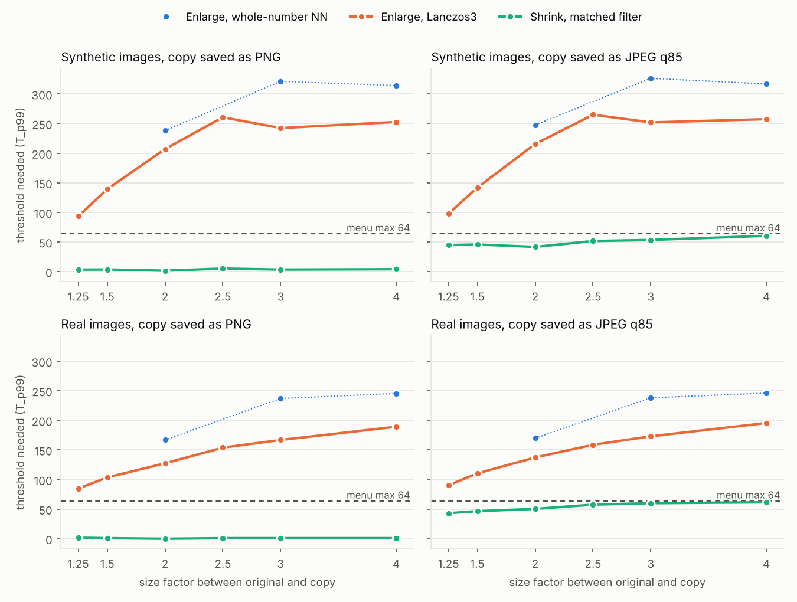
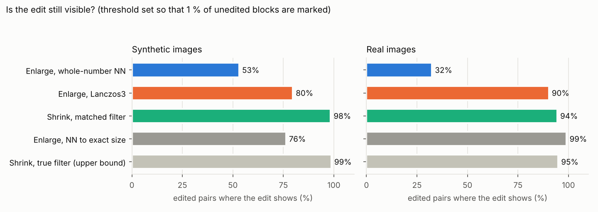

# Comparing images of different resolution in WinMerge: study report

*Session of 2026-10-14. Harness, data and page in this folder; findings log in `DISCOVERIES.md`.*

**In one paragraph.** To compare a picture with a resized copy of it, shrink the original to the
copy's size with the filter that reproduces the copy best; do not enlarge the copy. That makes an
unedited pair look clean (Pillow-made copies match exactly) and keeps 98 % of real edits visible,
where enlarging leaves about a third of the 8×8 blocks marked at threshold 16 and finds 53–82 % of edits. Whole-number
nearest neighbour is honest about the copy's pixels but is no better a comparison than Lanczos3,
and an unsharp mask on top of Lanczos3 is not worth it. All three modes are implemented for
WinIMerge (draft PR https://github.com/Ikkoru/winimerge/pull/2, alignment in
https://github.com/Ikkoru/winimerge/pull/1) with WinMerge menus (https://github.com/Ikkoru/winmerge/pull/1
and /pull/2). An eye-check page for flipping between the candidates:
https://claude.ai/artifact/6VCaQkq5egCxeAi9tqepCp (also `eyecheck/index.html`, works offline).

## 1. The question

WinMerge's image compare (WinIMerge) compares pixel by pixel at each image's own size, so a
picture and its lower-resolution copy never line up. The user compares duplicates found by a
duplicate finder (anime-style illustrations, manga, some photos); the low-resolution copy usually
comes from a website's resizing, often JPEG-compressed. Two features were requested:

1. place the smaller image in the centre instead of the top-left, and
2. enlarge the smaller image by the largest whole-number factor with nearest neighbour (NN),

with the question whether a smooth filter (e.g. Lanczos3 + a light unsharp mask) would make a
better comparison, and which filter settings are best. The brief (`notes/brief.md`, the user's
methodology document) asks for the best stand-in for the larger image, so
that flipping between the two shows what was changed and not what resampling did, measured with
tools that predict what a person sees when flipping.

## 2. Short answer

- **Compare at the smaller size.** Shrinking the original to the copy's size with the resampling
  filter that best reproduces the copy (WinIMerge `IMAGE_SCALING_DOWN_MATCHED`, "Shrink to Smallest
  (Matched Filter)") is the only way to make an unedited pair look clean, and it keeps real changes
  visible: on the synthetic set the threshold needed to leave ≤ 1 % of blocks marked is 2–5 for PNG
  copies and 42–60 for JPEG q85 copies (enlarging: 94–326), and 98 % of edits stay visible (Lanczos3
  enlargement 80 %, whole-number NN 53 %). Copies made with Pillow's resize or OpenCV's area
  averaging are reproduced exactly.
- **You were right that a smooth enlargement does not make the comparison truthful, but nearest
  neighbour does not either.** Any enlargement leaves about a third of the 8×8 blocks marked at threshold 16
  on detailed images, because the copy does not contain the detail. Whole-number NN marks about as many blocks as Lanczos3,
  with stronger differences, finds fewer edits, and cannot be used below 2× or without a border at
  factors like 2.5×. It is the right view for pixel art (where it beats Lanczos3) and for looking at the
  copy's own pixels, so it is in the PR as requested.
- **Lanczos3 + unsharp mask: not worth implementing.** Lanczos3 on FreeImage's float path is the best
  common enlarger; an unsharp mask (σ 0.5–1.5 px, 25–100 %) improves it by a few percent and sharpens
  JPEG noise with it. The enlargement mode in the PR is plain Lanczos3.
- **Implemented** as separate PRs in your forks: image alignment (nine anchors, including centre) and
  size matching (the three modes), each a library commit plus a small UI commit, with matching WinMerge
  menu PRs. The setting lives behind one API call, so the maintainer can put it wherever he wants.

## 3. What was tested

### 3.1 Test material

17 large originals, used at their native resolution (no image was resampled to make it "large"):

| Set | Images | Size | Notes |
|---|---|---|---|
| Synthetic (`testset/synth`, made by `harness/synth.py`) | line art, flat-colour anime-style cel shading, painterly strokes, manga page with screentone, UI/text, pixel art (×8 NN), zone plate | 1200–1600 px | Rendered with skia at the final size (vector anti-aliasing, as a drawing program renders strokes). No licence restrictions. |
| Real (`testset/real`, sources in `testset/sources/MANIFEST.md`) | Pepper&Carrot cover and "Witches" (David Revoy, CC BY 4.0), Krita anime banner (CC BY-SA 4.0), Hokusai *Hodogaya* (Met, CC0), *The Starry Night* (PD), lion photo (CC0), astronaut (NASA, PD), coffee (CC0), Kenney pixel-art tiles (CC0), kitty terminal screenshot (GPL-3.0) | 512–1920 px wide; larger sources cropped at native resolution to ≤1600×1200 | Crops chosen automatically as the most detailed window (`testset/real/CROPS.json`). Several are JPEGs already (q≈87–100). No public-domain manga page with screentone was found on the reachable hosts; the synthetic manga page stands in. |

### 3.2 How the small copies were made

Unknown for real copies, so varied (`harness/resample.py`, `SHRINKERS`):

| Shrinker | What it stands for |
|---|---|
| `area` | OpenCV `INTER_AREA` (exact area averaging; Discord's lilliput) |
| `pil_bilinear` | Pillow BILINEAR (antialiased triangle) |
| `cv_linear` | OpenCV `INTER_LINEAR` without prefilter (aliases) |
| `pil_bicubic` | Pillow BICUBIC (Keys a = −0.5 = Catmull-Rom, antialiased) |
| `pil_lanczos` | Pillow LANCZOS (Lanczos3, antialiased) |
| `mitchell` | Mitchell–Netravali B = C = 1/3 (float reference implementation) |
| `lanczos_linear` | Lanczos3 in linear light |
| `lanczos_sharpened` | Pillow LANCZOS + unsharp mask σ 0.6, 60 % |
| `vips` | libvips `resize` (Lanczos3 with shrink/reduce) |
| `nearest` | Pillow NEAREST |

Factors 1.25, 1.5, 2, 2.5, 3, 4, with the small size rounded per axis (so the two axes' factors
differ slightly, as with real copies). Saved as PNG, JPEG q95/q85/q75/q60 at 4:2:0, q85 at 4:4:4,
WebP q90/q75 (Pillow/libjpeg-turbo, decoded with the same library).

### 3.3 Edits

Applied to the large image before shrinking, as a real variant would differ (`harness/edits.py`),
each placed automatically where the image has content: small text (20 px and 11 px), a 2-px line,
a 90-px recolour (+18/−6/−18 RGB), a black bar, a 96-px mosaic, a smudge (Gaussian σ 3), a
110-px region moved 2 px, and a 3-px dot (≈1 small pixel at 3×: the detection floor).

### 3.4 Candidates (how WinIMerge could show the pair)

Enlarging the small copy to the original's size (FreeImage, the library WinMerge ships; its
8-bit path and a float path):

| Candidate | Description |
|---|---|
| `nn_int_center` / `nn_int_topleft` | NN by the largest whole-number factor (the requested feature), centred or top-left; the rest of the canvas is "missing" and counts as different, as in WinMerge |
| `nn` | NN to the exact size (uneven pixel widths at non-integer factors) |
| `sharp_bilinear` | NN by the whole-number factor, then bilinear to the exact size (CSS `image-rendering: pixelated` style) |
| `fi_bilinear`, `fi_bspline`, `fi_mitchell` | FreeImage filters |
| `fi_catmullrom`, `fi_lanczos3` | FreeImage, 8-bit intermediate (clips overshoot) |
| `fi_catmullrom_f`, `fi_lanczos3_f` | the same in float (`FreeImage_ConvertToRGBAF` first) |
| `ref_lanczos2_f`, `ref_lanczos4_f` | float reference implementation |
| `l3f_usm_rR_aA`, `crf_usm_…` | Lanczos3/Catmull-Rom float + unsharp mask, σ R ∈ {0.5, 0.75, 1, 1.5} px, amount A ∈ {25, 50, 75, 100} %, threshold 0 |
| `lin_lanczos3_f`, `lin_catmullrom_f` | resampled in linear light |

Comparing at the smaller size instead (shrinking the original to the copy's size):

| Candidate | Description |
|---|---|
| `down_area` | OpenCV area averaging |
| `down_fi_<k>` / `down_fi_<k>8` | FreeImage filter k (box, bilinear, B-spline, Mitchell, Catmull-Rom, Lanczos3), float / 8-bit path |
| `down_matched8a` | **WinIMerge's `IMAGE_SCALING_DOWN_MATCHED`**: FreeImage's box, bilinear, Mitchell, Catmull-Rom and Lanczos3 on the 8-bit path, plus exact area averaging; the one with the lowest mean absolute difference to the copy, chosen per pair |
| `down_matched8` | the same without the area-averaging candidate (the first version of the PR) |
| `down_matched` | the same choice among six filters (B-spline too) on the float path (an earlier variant; kept for comparison) |
| `down_oracle` | the shrinker that really made the copy (an upper bound) |

### 3.5 Measures

For every pair, against the large original (or, for `down_*`, the copy against the shrunk original):

- **WinMerge's own outcome**: the share of 8×8 blocks it marks (colour distance > T over R, G, B)
  at T = 0, 2, 4, 8, 16, 32, 64; regions (8-connected); and **T_p99**, the threshold that leaves
  at most 1 % of blocks marked. T_p99 is the single most practical number: the colour-distance
  setting a user would need before the diff stops being yellow everywhere.
- PSNR; worst-8×8-block mean colour distance; SSIM (global and worst 64-px tile).
- On a subset: **ꟻLIP** (NVIDIA; models flipping between two images) at 96 pixels per degree
  (the user's BenQ RD280U at 85 cm, 1:1 pixels) and 48 (2× zoom, or a DPI-unaware 200 % stretch),
  **Butteraugli** max and 3-norm, **SSIMULACRA2** (libjxl tools).
- **Edit detectability**: blocks touched by the edit (in the large image) vs. all other blocks
  (a guard ring of 3·factor+2 px around the edit is excluded). At the threshold that leaves 1 %
  (0.1 %) of blocks marked in the unedited twin pair, the share of edit blocks still marked, and
  whether any edit block is marked at all ("edit visible"); plus the number of unedited blocks
  louder than the edit's strongest block.

### 3.6 Controls and geometry checks (run first)

- Every metric returns "identical" for an image against itself (block distance 0, PSNR ∞,
  ꟻLIP 0, Butteraugli 0, SSIMULACRA2 100) — `harness/metrics.py` self-test.
- The float reference resampler reproduces FreeImage's float path exactly (max |Δ| 0.0000, five
  kernels, both directions); WinMerge's FreeImage fork resamples bit-identically to FreeImage 3.18.
- Centroids of Gaussian blobs at sub-pixel positions stay within 0.04 px through every
  antialiased shrinker and a FreeImage enlargement (pixel-centre convention everywhere), except
  Pillow NEAREST at even factors (0.5 px shift) and NN enlargement at non-integer factors.
- Image borders are included in every number. Leaving out the outermost ring of 8×8 blocks changed
  T_p99 by at most 0.5 (matched shrink) and 1.7 (Lanczos3) and the share of blocks marked by less than
  half a point (27 pairs), so the libraries' different edge handling does not matter here.
- The WinIMerge implementation (C++) produces bit-identical output to the harness for all three
  scaling modes (Linux unit tests with the real `ImgDiffBuffer.hpp`). The one exception is the
  area-averaging candidate, for which the harness uses OpenCV's `INTER_AREA`: the C++ resampler agrees
  with it to within 1 level (0.2 % of the values differ).

## 4. Results

All numbers below are medians unless stated otherwise. `results/tables.md` has every table (generated by
`harness/report.py`, each table computed on the same pairs for all its rows); the CSVs are in `results/`.

### 4.1 Unedited pairs: how much does each WinIMerge mode leave marked?



Synthetic set, 7 images × 10 ways of making the copy = 70 pairs per cell; the three modes exactly as
WinIMerge implements them (whole-number NN; Lanczos3 on FreeImage's 8-bit path; the matched shrink
with its six candidates). **T_p99** is the colour-distance threshold that leaves at most 1 % of the
8×8 blocks marked (for scale: WinIMerge's threshold menu offers 0–64; the distance runs to 510):

| copy saved as | mode | 1.25× | 1.5× | 2× | 2.5× | 3× | 4× |
|---|---|---|---|---|---|---|---|
| PNG | enlarge, whole-number NN | – | – | 238 | – | 321 | 314 |
| PNG | enlarge, Lanczos3 | 94 | 139 | 207 | 261 | 242 | 253 |
| PNG | **shrink, matched filter** | **3** | **4** | **2** | **5** | **3** | **4** |
| JPEG q85 | enlarge, whole-number NN | – | – | 248 | – | 326 | 317 |
| JPEG q85 | enlarge, Lanczos3 | 98 | 142 | 216 | 265 | 252 | 257 |
| JPEG q85 | **shrink, matched filter** | **45** | **46** | **42** | **52** | **53** | **60** |

"–": whole-number NN does nothing below 2× and leaves a border at 2.5× (k = 2), which WinMerge marks.

Share of blocks still marked at the thresholds WinIMerge's menu offers (PNG copies / JPEG q85 copies):

| mode | factor | T = 8 | T = 16 | T = 32 | T = 64 |
|---|---|---|---|---|---|
| enlarge, whole-number NN | 2× | 37 % / 49 % | 35 % / 38 % | 33 % / 33 % | 16 % / 20 % |
| enlarge, Lanczos3 | 2× | 40 % / 53 % | 37 % / 42 % | 35 % / 35 % | 17 % / 23 % |
| shrink, matched filter | 2× | 0 % / 58 % | 0 % / 42 % | 0 % / 5 % | 0 % / 0.1 % |
| enlarge, whole-number NN | 2.5× | 92 % / 93 % | 82 % / 83 % | 78 % / 78 % | 71 % / 71 % |
| enlarge, Lanczos3 | 2.5× | 47 % / 55 % | 38 % / 45 % | 35 % / 36 % | 33 % / 34 % |
| shrink, matched filter | 2.5× | 0 % / 61 % | 0 % / 51 % | 0 % / 8.5 % | 0 % / 0.3 % |

What this says:

- **Shrinking is the only mode in which an unedited pair can look clean.** With PNG copies even a
  threshold of 8 leaves no block marked (median); with JPEG q85 copies the compression noise needs 64
  (≤ 0.4 % of blocks marked at every factor). The enlargers leave 8–35 % of the blocks marked even at
  64 (about a third from 2.5× up): the detail lost in the copy cannot be put back.
- **At whole-number factors, NN and Lanczos3 mark about the same share of blocks**; NN slightly fewer
  at low thresholds (it keeps flat areas exactly flat, while a smooth filter spreads each edge's error
  over more blocks), but its differences are stronger (T_p99 238 vs 207 at 2×, 321 vs 242 at 3×).
- **JPEG noise moves the problem**: at the small size a JPEG copy's noise is not diluted by enlarging,
  so at T = 8–16 the shrink mode marks as many blocks as the enlargers. It needs a higher threshold
  (64) but then gets clean; the enlargers never do.

By image (PNG copies, all factors): the matched shrink needs a threshold of 2–10 for every image (the
manga page with screentone is the hardest, at 10), the enlargers 79–342. **Pixel art is the one case
where whole-number NN beats Lanczos3** (24 vs 82); the matched shrink is better still (2).

### 4.2 How well does the matched filter reproduce the copy?

Which candidate the WinIMerge rule picks (synthetic, PNG copies, 42 pairs per way of making the copy):

| copy made with | picked | median T_p99 of the shrunk original vs the copy |
|---|---|---|
| Pillow BICUBIC | Catmull-Rom 42/42 | 0 (exact) |
| Pillow BILINEAR | bilinear 42/42 | 0 (exact) |
| Pillow LANCZOS | Lanczos3 42/42 | 0 (exact) |
| OpenCV `INTER_AREA` | area 40, box 2 | 0 (exact) |
| Mitchell (float reference) | Mitchell 42/42 | 1.7 (rounding) |
| libvips `resize` | Lanczos3 42/42 | 14 |
| Pillow LANCZOS + unsharp mask | Lanczos3 40, box 2 | 63 |
| OpenCV `INTER_LINEAR` (no antialiasing) | area 26, box 13, other 3 | 63 |
| Lanczos3 in linear light | Lanczos3 25, Catmull-Rom 12, other 5 | 76 |
| Pillow NEAREST | box 30, area 10, Lanczos3 2 | 196 |

- Choosing per pair beats any fixed filter: against a fixed Catmull-Rom shrink (8-bit) the matched
  shrink needs a lower threshold in 75 % of pairs, the same in 14 % and a higher one in 11 % (median
  T_p99 2.2 vs 42.6 for PNG copies, 48 vs 62 for JPEG q85). The true resampler (an upper bound no tool
  can know) gets 0 for PNG and 38 for JPEG q85.
- How often the pick is the resampler that really made the copy (where one of the candidates is it):
  99 % (synthetic) and 100 % (real) for PNG copies, but only 73 % and 56 % for JPEG q85 copies, where the
  compression removes the fine detail that tells the filters apart and a softer filter often wins.
  The outcome hardly suffers (next point).
- Picking by mean absolute difference is close to the best possible pick: judged by the outcome itself
  (each candidate's own T_p99 on the pair), it is within 1 level of the best candidate in 88 % of PNG
  pairs and 80 % of JPEG pairs, with the same median for PNG (2.2) and 48 vs 46 for JPEG. A fancier
  selection rule would gain little.
- The area-averaging candidate matters: without it (the PR's first version, five FreeImage filters)
  the medians were 10.4 (PNG) and 50.6 (JPEG), because FreeImage's box filter reproduces area averaging
  only at whole-number factors (`DISCOVERIES.md` §7).
- The 8-bit path matters: Pillow rounds to 8 bits between its two passes, as FreeImage's 8-bit path
  does, so the 8-bit FreeImage shrink reproduces Pillow copies exactly where the float path is off by
  a few levels (`DISCOVERIES.md` §3, §7).
- Copies that cannot be reproduced exactly are those whose resampler is in none of the candidates:
  linear-light resizing, sharpening after resizing, no antialiasing (nearest, OpenCV linear). They
  still compare far better than any enlargement.

### 4.3 Enlargers compared, and the unsharp mask

Over all factors and both codecs (synthetic), median T_p99 and mean rank among the enlargers
(1 = needs the lowest threshold on that pair):

| enlarger | T_p99 PNG | T_p99 JPEG q85 | mean rank | blocks @T16 PNG |
|---|---|---|---|---|
| Lanczos4 (float) | 191 | 198 | 4.4 | 38.3 % |
| Lanczos3 + USM σ0.75 50 % | 190 | 194 | 4.5 | 37.9 % |
| **Lanczos3 (float)** | **195** | **199** | **4.6** | **37.6 %** |
| Lanczos3 + USM σ1.0 50 % | 188 | 196 | 4.9 | 38.2 % |
| Lanczos2 (float) | 206 | 209 | 5.5 | 37.7 % |
| Catmull-Rom (float) | 208 | 210 | 5.6 | 37.5 % |
| Mitchell | 211 | 213 | 6.3 | 38.0 % |
| bilinear | 215 | 219 | 7.2 | 38.0 % |
| NN whole-number, then bilinear to size | 236 | 240 | 8.4 | 36.4 % |
| NN to the exact size | 275 | 278 | 10.0 | 36.0 % |

- The Lanczos family is best by the threshold needed; Lanczos3 is FreeImage's built-in and within
  2 % of Lanczos4. The float path and the 8-bit path give the same medians here (the clipping matters
  at individual hard edges, `DISCOVERIES.md` §1).
- **Unsharp mask after Lanczos3 lowers the needed threshold by 2–4 %** (PNG and JPEG copies alike)
  **but marks more blocks at T = 16 with JPEG copies** (43.5–44.1 % instead of 41.9 %), because it
  sharpens the JPEG noise and the ringing along with the edges.
  The full grid (σ 0.5–1.5 px × 25–100 %) is in section 4.5 once that run completes. Not worth a mode.
- Nearest neighbour to the exact size is the worst by threshold, though it marks the fewest blocks at
  T = 16 for the reason given in 4.1.

### 4.4 Edits: can a real change still be seen?



1008 edited pairs (synthetic: 7 images × 9 edits × 2 shrinkers (area, Pillow Lanczos) × factors 2, 2.5,
3, 4 × PNG and JPEG q85). For each pair the threshold is set where 1 % of the *unedited* blocks of its
unedited twin are marked (a strict but fair setting: the user tunes the threshold until the noise
is gone), and the edit counts as visible when at least one of its blocks is still marked.

| mode | edit visible | … at the 0.1 % threshold | share of the edit's blocks marked | unchanged blocks louder than the edit (median) |
|---|---|---|---|---|
| enlarge, whole-number NN | 53 % | 34 % | 29 % | 198 |
| enlarge, NN to exact size | 76 % | 60 % | 41 % | 8 |
| enlarge, bilinear | 72 % | 60 % | 40 % | 8 |
| enlarge, Catmull-Rom (float) | 77 % | 65 % | 44 % | 0 |
| **enlarge, Lanczos3 (WinIMerge UP_SMOOTH)** | **80 %** | **66 %** | **46 %** | **0** |
| enlarge, Lanczos3 + USM σ1.0 50 % | 82 % | 68 % | 48 % | 0 |
| shrink, fixed Catmull-Rom (8-bit) | 94 % | 89 % | 78 % | 0 |
| shrink, five FreeImage filters matched (first version) | 97 % | 93 % | 85 % | 0 |
| **shrink, matched filter (WinIMerge DOWN_MATCHED)** | **98 %** | **94 %** | **87 %** | **0** |
| shrink, the true filter (upper bound) | 99 % | 95 % | 88 % | 0 |

The matched shrink is within one point of the upper bound (knowing the true resampler). By edit
(share visible): the hardest edits are the faint recolour (+18/−6/−18 RGB over 90 px: matched shrink
89 %, Lanczos3 54 %, whole-number NN 37 %), the smudge (96 % / 67 % / 24 %) and the 3-px dot, which is
about one pixel of the copy at 3× (100 % / 62 % / 38 %). Text, bars, lines, mosaics and moved regions
are found by every smooth mode almost always. By factor, the matched shrink stays at 96–99 %, Lanczos3
falls from 89 % (2×) to 67 % (4×), and whole-number NN is at 0 % at 2.5× (the uncovered border is
always marked, so no threshold leaves only the edit) and 58–87 % elsewhere. PNG and JPEG q85 copies
differ little (matched shrink 100 % vs 97 %).

The unsharp mask makes edits slightly easier to see among the enlargers (82 % vs 80 %, mostly the
small dot and the small text), but comparing at the smaller size is far ahead of any enlarger.

<!-- RESULTS-EDITS -->

### 4.5 Real images

10 real originals (illustrations, a woodblock print, a painting, photos, pixel-art tiles, a terminal
screenshot; `testset/sources/MANIFEST.md`), copies made with 7 resizers (Pillow bilinear/bicubic/Lanczos,
libvips, OpenCV area and linear, Lanczos in linear light) at the same six factors, PNG and JPEG q85:
840 pairs per mode. Median T_p99 (70 pairs per cell):

| copy saved as | mode | 1.25× | 1.5× | 2× | 2.5× | 3× | 4× |
|---|---|---|---|---|---|---|---|
| PNG | enlarge, whole-number NN | – | – | 167 | – | 237 | 246 |
| PNG | enlarge, Lanczos3 | 85 | 104 | 127 | 154 | 167 | 189 |
| PNG | **shrink, matched filter** | **2** | **1** | **0** | **1** | **1** | **1** |
| JPEG q85 | enlarge, whole-number NN | – | – | 170 | – | 238 | 246 |
| JPEG q85 | enlarge, Lanczos3 | 90 | 111 | 137 | 159 | 173 | 196 |
| JPEG q85 | **shrink, matched filter** | **43** | **47** | **50** | **58** | **60** | **62** |

- Same picture as the synthetic set, more clearly: with PNG copies the matched shrink leaves **no**
  block marked at threshold 16 at any factor (median), while Lanczos3 leaves 37–65 % and whole-number NN
  55–99 %. At threshold 64 the matched shrink leaves ≤ 0.8 % even with JPEG copies; Lanczos3 3–25 %.
- Per image (PNG copies): the matched shrink needs 0–1 for every image; Lanczos3 53 (the painterly
  Pepper&Carrot cover) to 244 (the pixel-art tiles); NN 127–327. With JPEG q85 copies the matched shrink
  needs 40–60 for illustrations, paintings and photos, but 93 for the pixel-art tiles and 116 for the
  terminal screenshot: JPEG at the small size is hard on text and hard pixel edges.
- Per resizer (PNG copies): Pillow's three and OpenCV's area copies are reproduced exactly (0–1),
  libvips closely (6), OpenCV `INTER_LINEAR` (49) and linear-light Lanczos (71) cannot be. The picks
  were right every time for the reproducible ones (60/60 each).

### 4.6 JPEG chroma upsampling

Does it matter how the decoder upsamples a 4:2:0 JPEG's colour? 42 synthetic pairs (7 images ×
Pillow Lanczos and area × factors 2, 2.5, 3), copy saved as JPEG q85 4:2:0, decoded by libjpeg-turbo's
`djpeg` with its default smooth ("fancy") chroma upsampling and with `-nosmooth` (replicated chroma;
`harness/chroma_test.py`):

| mode | upsampling | median T_p99 | blocks @T16 | blocks @T64 |
|---|---|---|---|---|
| shrink, matched filter | smooth (default) | 40 | 44 % | 0 % |
| shrink, matched filter | replicated | 42 | 49 % | 0 % |
| enlarge, Lanczos3 | smooth (default) | 249 | 45 % | 33 % |
| enlarge, Lanczos3 | replicated | 249 | 48 % | 33 % |

The decoder's default is slightly better (2 levels, 3–5 points of blocks at threshold 16) and the
difference is far smaller than the JPEG noise itself. FreeImage's JPEG plug-in uses libjpeg's default.

<!-- RESULTS-MORE -->


## 5. Is anything other than nearest neighbour a flawed comparison?

Partly right, but the measurements turn the argument around.

**What whole-number NN does well.** Every pixel it shows is a pixel of the copy, unchanged, and
nothing is invented. That is the right view when looking *at the copy* (pixel art, checking its
compression artefacts, counting pixels), and when the copy was itself made by whole-number NN the
comparison becomes exact (no differences at all; unit-tested).

**What it does to the comparison.** WinMerge compares what is shown with the original, pixel by
pixel. The original has its edges at full resolution; the NN-enlarged copy has the same edges as
k×k staircases. So every edge in the picture differs, by up to its full contrast, and NN needs a
*higher* threshold than any smooth filter before the diff stops being yellow everywhere (section 4).
NN avoids inventing values, but it does not avoid differences: it adds them. At factors that are not
whole numbers it also leaves part of the canvas uncovered (below 2× it does nothing at all; at 2.5×
it enlarges 2× and leaves a 20 % border), and NN to the exact size makes pixels unevenly wide and
moves features by up to half a copy pixel (`DISCOVERIES.md` §2).

**What a smooth filter does.** It estimates in-between values. The estimate is wrong exactly where the
copy lost detail, but it is closer to the original than a staircase, so fewer and weaker differences
remain. Lanczos3 is the closest of the common filters by every measure used here. Still, on detailed
images about a third of all 8×8 blocks stay marked at threshold 16 whatever enlarger is used: the
detail is not in the copy, so no filter can bring it back, and an enlarged comparison can never be
clean.

**Lanczos3 + unsharp mask.** Sharpening moves the enlarged copy towards the original's edge contrast:
the threshold needed drops by 2–4 % and slightly more edits stay visible (82 % instead of 80 %). But it
also sharpens ringing and JPEG noise (more blocks marked at low thresholds with JPEG copies), and it
stays far behind comparing at the smaller size (98 %). Not worth a mode of its own (section 4.3–4.4).

**The honest comparison is at the smaller size.** Shrink the original the way the copy was made.
Then both images went through the same resampling, and what remains is what really differs: edits
and compression noise. That is WinIMerge's `IMAGE_SCALING_DOWN_MATCHED`. The cost is that
differences smaller than one pixel of the copy cannot be seen, but the copy cannot show them anyway.

The brief also suggested a variant: after the matched shrink, enlarge *both* images with the same
filter and compare at the large size, so both carry the same blur. That shows the same differences as
comparing at the small size, spread over k² times as many pixels, at the cost of a second resample of
both images and of comparing at the large size (about 15× slower per comparison at 4×, section 8). Zooming
in on the small comparison (WinMerge's zoom uses nearest neighbour) shows the same thing without
inventing in-between values, so only the compare-at-the-smaller-size version was implemented.

## 6. Recommendations

For the WinIMerge/WinMerge feature (implemented in the PR branches, see `notes/upstream-drafts.md`):

1. Offer **Shrink to Smallest (Matched Filter)** as the mode for resized copies, **Enlarge by Whole
   Number (Nearest Neighbor)** for pixel art and for inspecting the copy, and **Enlarge to Largest
   (Lanczos)** for viewing a small copy next to the original at the same size. Keep **None** as the
   default (today's behaviour).
2. Match the filter on FreeImage's 8-bit path (what Pillow and most libraries do), choose by the
   lowest mean absolute difference, and enlarge on the float path (no clipped overshoot).
3. No unsharp-mask option.
4. Image alignment **Center** is the useful companion when sizes still differ (crops, letterboxing,
   or a factor where whole-number NN leaves a border).

For comparing duplicates by eye (your use):

- Use *Shrink to Smallest*; it is the only mode where a clean pair looks clean.
- Set the colour-distance threshold (WinMerge: Image > Ignore Color Difference) by how the copy was
  saved. With a lossless copy (PNG, or your jpegQS-restored PNGs: see section 4.8 once that run is in),
  8–16 leaves nothing marked unless something changed (the matched shrink needs 0–5 for copies from
  Pillow, OpenCV area averaging and libvips). With JPEG q85 copies the compression noise needs 64, the
  highest menu value (≤ 1 % of blocks marked; real edits stayed visible in 97 % of JPEG pairs at the
  equivalent threshold). Section 4.7 gives the values for other JPEG and WebP qualities.
- Make sure WinMerge is not bitmap-stretched by Windows (section 7), and zoom in (200 % or more) on the
  small comparison: at the copy's resolution one pixel is small on a 4K screen.

For your video comparisons (the brief: the lower-resolution side enlarged with FFmpeg's Lanczos, then a
difference blend) the same reasoning applies: enlarging leaves the lost detail as a difference along
every edge in every frame. Scaling the *larger* video down to the smaller one's size and blending there
shows only what really differs (and JPEG-like compression noise). With FFmpeg, for example
`-filter_complex "[0:v]scale=W:H:flags=lanczos[a];[a][1:v]blend=all_mode=difference"` where W×H is the
smaller video's size; try `flags=bicubic` (FFmpeg's default scaler, B = 0, C = 0.6), `bilinear` or
`area` as well, and keep the one whose difference is darkest on an unedited stretch, which is what
WinIMerge's matched shrink does automatically. Not measured for video in this study.

## 7. Viewing conditions

`DISCOVERIES.md` §6 has the details. In short: WinMerge declares no DPI awareness, so on a 200 %
display Windows stretches it with smoothing and one image pixel covers 2×2 device pixels; fine
differences are then attenuated. ꟻLIP was run at 96 pixels per degree (BenQ RD280U at 85 cm, 1:1
pixels) and 48 (2× stretch or zoom); the HP 23xw (≈53–59) and the Packard Bell Maestro 226DX (≈55–62)
fall between. How the candidates compare at the two densities is in section 4.6.

## 8. The WinIMerge implementation in brief

- Scaling happens in `CImgDiffBuffer::PreprocessImages()` (inside the temporary rotation/flip), so the
  comparison, overlays, blinking, insertion/deletion detection and the diff map see equal-size images
  without other changes; the originals are untouched and saving, undo and edits act on them.
- Scaled images are cached (key: hash of the source and of the reference image, target size, mode),
  because `CompareImages()` runs again on every option change.
- All resampling uses FreeImage's 8-bit path (Lanczos3 on the float path measured no better for
  comparison and cost 2.4× the time; `DISCOVERIES.md` §1). The matched shrink tries five FreeImage
  filters and an exact area-averaging resampler, picks by mean absolute difference, and keeps the pick
  for the image pair and size, so an edit costs one resample instead of six.
- `ConvertToRealPos()` maps a canvas pixel to the original pixel it came from; selection edges map so
  that a selection holds the original pixels whose centres lie inside it; `CopyDiff()` copies the pixels
  a scaled pane shows into every original pixel of the destination they stand for, and does not copy
  into a pane shown through a smoothing filter (the difference would grow instead of disappear).
- The C++ output is bit-identical to this harness for all three modes (unit test + `harness/fi.py`);
  the area resampler is within 1 level of OpenCV's `INTER_AREA`, which the harness uses for it.
- Cost, at the brief's example size (a 1000×1500 copy of a 4000×6000 original; Linux, one thread,
  `-O2`, measured while the experiments kept all four cores busy, so on the slow side;
  `tools/winimerge-linux-test/test_timing.cpp`): comparing the unscaled pair takes 0.9 s. Switching on
  the matched shrink takes 2.2 s once (six resamples of the original); afterwards an option change takes
  0.07 s and an edit of the original 0.7 s (one resample), because everything is compared at the small
  size. The enlarging modes take 1.6–1.8 s to switch on and about 1.1 s for every later comparison
  (comparing 24 megapixels), with the enlargement cached.
- An independent review with a randomized AddressSanitizer stress test found no new crash in either
  branch; its findings (performance of re-matching, copies into smoothed panes, alignment after a
  growing copy, undo placement) were fixed, and two pre-existing out-of-bounds bugs it confirmed are
  fixed in a separate PR.

## 9. What was not tested

- Copies made by Windows' own scalers (WIC Fant and high-quality cubic, Direct2D, GDI+), browsers
  (canvas `drawImage`), Photoshop ("Bicubic Sharper"), GIMP (NoHalo/LoHalo) or Paint.NET
  (supersampling): not available on Linux. WIC Fant and Paint.NET supersampling are area-averaging-like,
  which FreeImage cannot reproduce at non-integer factors (`DISCOVERIES.md` §7).
- Copies that were also cropped, padded, rotated, colour-converted (ICC profiles, gamma), resized twice
  or recompressed several times; factors above 4; very small thumbnails.
- Learned super-resolution (waifu2x, Real-ESRGAN) as an enlarger: it invents plausible detail, which is
  the opposite of what a diff needs.
- A real manga page with screentone (no freely licensed one was reachable; the synthetic page stands in).
- Your own pairs: the harness runs on them offline (`harness/compare_pairs.py`, section 10).
- The eye-check page was built and checked to work, but no person has looked through it yet; ꟻLIP,
  Butteraugli and SSIMULACRA2 stand in for the eye.
- The WinIMerge/WinMerge changes were compiled with MinGW and unit-tested on Linux, not built with MSVC
  or run on Windows.

## 10. Reproducing and running it on your own pairs

See `harness/README.md`. In short (Linux or WSL, Python 3 with numpy, opencv-python, pillow, scipy,
skia-python, flip-evaluator; FreeImage 3.18 via `FREEIMAGE_LIB`; libjxl tools for Butteraugli and
SSIMULACRA2 via `LIBJXL_TOOLS`):

```
python3 harness/compare_pairs.py FOLDER [--heavy] [--eyecheck OUTDIR]   # your own pairs
python3 harness/study.py run spurious --images testset/large --tag synth  # the study (resumable)
python3 harness/report.py && python3 harness/charts.py                    # tables and charts
python3 harness/eyecheck.py --out eyecheck                                # the flip page
```
